:::: {.columns}

::: {.column width="45%"}

### Agriculture

[fieldopt](https://cran.r-project.org/package=fieldopt) v0.1.0: Facilitates the design of agricultural and other area-frame and dual-frame (area plus list) sample surveys that go to the field, with the real cost of field work including travel between sampling units plus interviews, next to the variance of the design-based estimator. Includes travel matrices from coordinates or a road network,  stratified spatially balanced or spatially ordered systematic selection of segments with interpenetrating replicates, Horvitz-Thompson estimation with local-mean or replicate variances, cost-aware allocation across strata and more. The computational engine is the `Rust` crate `fieldopt-core`. There are seven vignettes including [Get started](https://cran.r-project.org/web/packages/fieldopt/vignettes/fieldopt.html) and [Routing for one or several teams](https://cran.r-project.org/web/packages/fieldopt/vignettes/routing-teams.html).

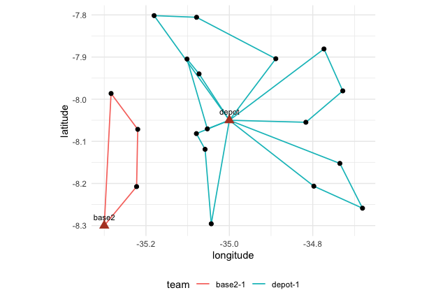{fig-alt="Plot showing routes for two teams"}

### Control Charts

[edetect](https://cran.r-project.org/package=edetect) v0.1.0: Implements sequential change detection for process monitoring with e-detectors [Shin, Ramdas and Rinaldo (2024)](doi:10.51387/23-NEJSDS51): nonparametric, anytime-valid analogues of the [CUSUM and Shiryaev-Roberts](https://www.mdpi.com/2075-1680/14/9/713) charts whose average run length to a false alarm is guaranteed for every distribution in a declared pre-change class (bounded, sub-Gaussian, Bernoulli or Poisson observations). Phase I/Phase II workflow, individual, p, c, u and regression charts, run-length simulation and auditable alarm reports. There are four vignettes including [Get started](https://cran.r-project.org/web/packages/edetect/vignettes/edetect.html) and [Regression chart for non-stationary processes](https://cran.r-project.org/web/packages/edetect/vignettes/regression-chart.html).

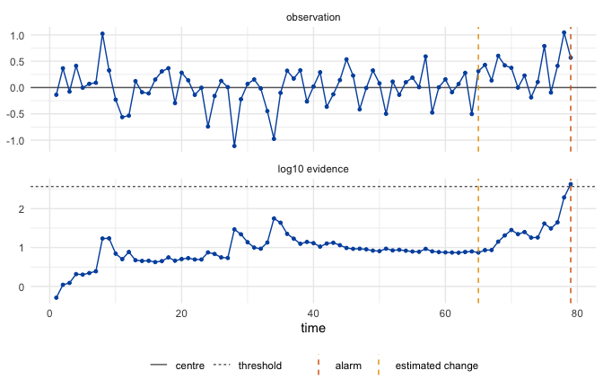{fig-alt="Plot of control charts with change points"}

### Decision Theory

[paretoinfer](https://cran.r-project.org/package=paretoinfer) v0.1.0: Sequential identification of epsilon-Pareto-optimal alternatives among a finite set with noisy, possibly correlated objectives. Simultaneous anytime-valid confidence sequences for every objective of every alternative [Waudby-Smith and Ramdas (2024)](doi:10.1093/jrsssb/qkad009) certify, at any time, which alternatives are epsilon-dominated and which are not, report the estimated frontier, the plausible Pareto set and the certified-dominated set, propose the next alternative to evaluate, and record an auditable result contract. There are four vignettes including [Get started](https://cran.r-project.org/web/packages/paretoinfer/vignettes/paretoinfer.html) and [Heterogeneous cost and budgets](https://cran.r-project.org/web/packages/paretoinfer/vignettes/cost-and-budget.html).

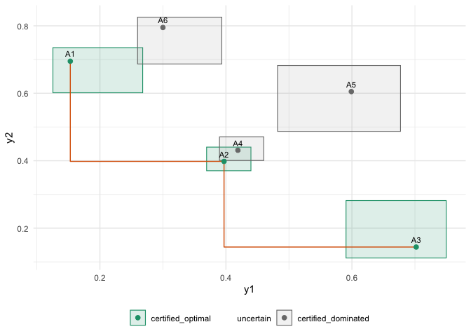{fig-alt="Plot showing most plausible alternatives"}

### Environmental Studies

[EnvRtype](https://cran.r-project.org/package=EnvRtype) 0.1.3: Provides an enviromics toolkit for genotype-by-environment analysis and envirotype-informed genomic prediction. Collects worldwide daily and hourly weather data, soil profiles, elevation and bioclimatic layers data, agro-ecological zone data, and downscaled climate scenarios, with checkpointed retrieval that can resume after an interrupted run. Derives agro-meteorological parameters and maps daily weather onto crop developmental stages. Fits Bayesian reaction-norm kernel models and predicts trained genotypes at untested locations and planting dates, with coverage diagnostics, spatial mapping and planting-window optimization. Methods are described in [Costa-Neto et al. (2021)](doi:10.1093/g3journal/jkab040), and build on the Bayesian genotype-by-environment kernel sampler of [Granato et al(2018)](doi:10.1534/g3.118.200435). See the [vignette](https://cran.r-project.org/web/packages/EnvRtype/vignettes/EnvRtype.html).

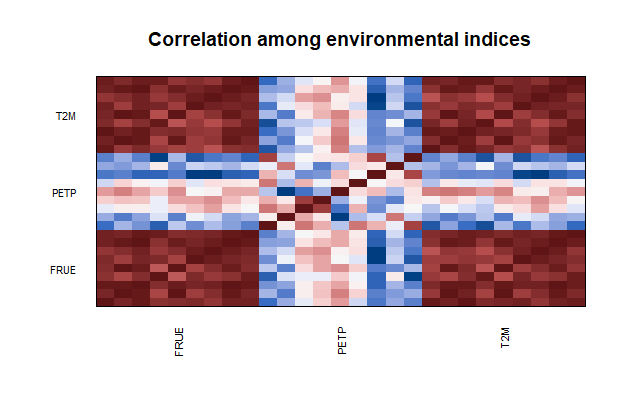{fig-alt="Heat map of correlation among environmental incdices"}

[ET0MassModels](https://cran.r-project.org/package=ET0MassModels) v1.0.0: Provides functions to estimate daily reference evapotranspiration  using 10 mass transfer-based empirical models, with the [Food and Agriculture Organization Penman-Monteith](https://en.wikipedia.org/wiki/Penman%E2%80%93Monteith_equation) method included as the standard reference for model comparison. Includes statistical evaluation metrics, such as Nash-Sutcliffe efficiency, root mean square error, mean absolute error, and mean bias error, and visualization tools. Based on [Singh et al. (2026)](doi:10.1016/j.ejrh.2026.103925). See the [vignette](https://cran.r-project.org/web/packages/ET0MassModels/vignettes/introduction.html).

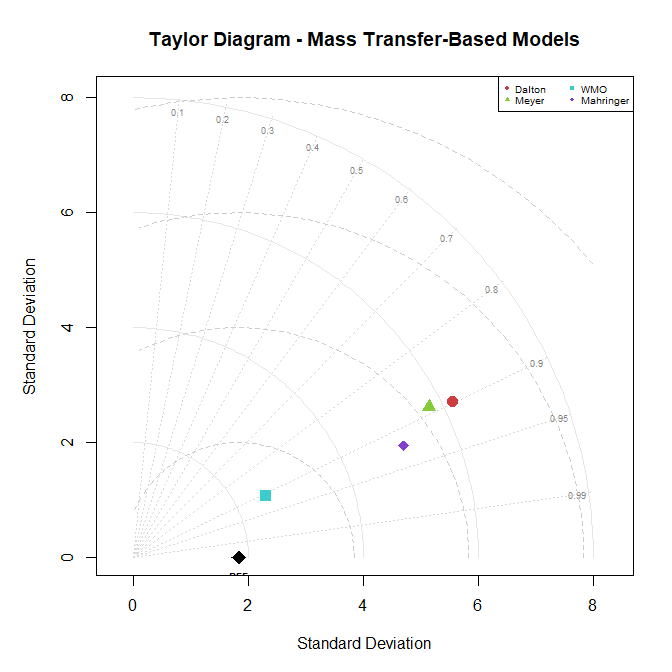{fig-alt="Taylor diagram - Mass Transfer-Based Models"}

### Ecology

[aquats](https://cran.r-project.org/package=aquats) v1.2.2: Implements a comprehensive statistical and visualization toolkit tailored for  observational data in fisheries science and aquatic ecology. Provides ANOVA, ANCOVA, MANOVA, permutational multivariate analysis of variance, similarity percentages, generalized linear models, non-linear morphometric regressions, two-group hypothesis testing, and chi-square tests. Methodological formulations for multivariate permutation tests follow [Anderson (2001)](oi:10.1111/j.1442-9993.2001.01070.pp.x). Ecological community dissimilarity transformations follow [Legendre and Gallagher (2001)](doi:10.1007/s004420100716), and ecotoxicological contamination index models follow [Tomlinson et al. (1980)](doi:10.1007/BF02414780). See the [vignette](https://cran.r-project.org/web/packages/aquats/vignettes/aquats-tutorial.html) for examples.

{fig-alt="ANOVA plots"}

[b3gbi](https://cran.r-project.org/package=b3gbi) v1.1.3: Calculate general biodiversity indicators from species occurrence cubes, such as those produced by the Global Biodiversity Information Facility [occurrence cube service](https://techdocs.gbif.org/en/data-use/data-cubes). Indicators include observed and coverage-based rarefied species richness and Hill numbers, evenness, rarity, taxonomic distinctness, occupancy, turnover and sample completeness, and can be calculated over time or space, with bootstrap confidence intervals. For details see [Dove (2026)](doi:10.21105/joss.10963). See the vignettes [A Gentle Introduction](https://cran.r-project.org/web/packages/b3gbi/vignettes/b3gbi.html) and [Uncertainty in Biodiversity Indicators](https://cran.r-project.org/web/packages/b3gbi/vignettes/uncertainty.html).

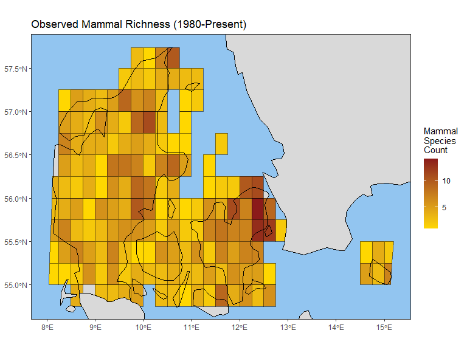{fig-alt="Map of observed mammal richness"}

[flexsdm](https://cran.r-project.org/package=flexsdm) v1.4.2: Provides a flexible and comprehensive workflow for species distribution modeling, from data preparation to model fitting, tuning, evaluation, prediction, ensemble modeling, and post-processing. The package is described in [Velazco et al. (2022)](doi:10.1111/2041-210X.1387). Implemented methods include the Shape metric to measure model extrapolation of [Velazco et al. (2023)](doi:10.1111/ecog.06992), ensembles of small models of [Breiner et al. (2015)](doi:10.1111/2041-210X.12403), Gaussian process models of [Golding and Purse (2016)](doi:10.1111/2041-210X.12523), and occurrence-based constraints for post-processing predictions of [Mendes et al. (2020)](doi:10.1016/j.ecolmodel.2020.109180). There are eight vignettes including [Overview of Modeling functions](https://cran.r-project.org/web/packages/flexsdm/vignettes/v02_modeling.html) and [Red Fir example](https://cran.r-project.org/web/packages/flexsdm/vignettes/v04_Red_fir_example.html).

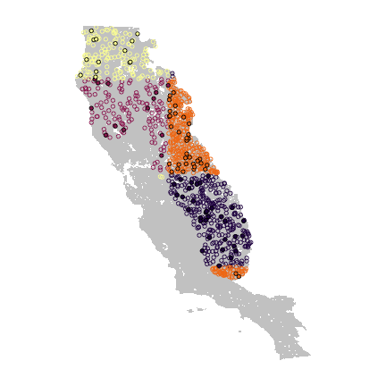{fig-alt="Map with pseudo-absence background points"}

[soilcnn](https://cran.r-project.org/package=soilcnn) v0.1.0: Implements a framework, built on `torch`, for mapping a soil property from point observations and a stack of aligned rasters with a convolutional network that reads the neighborhood of each point. It extracts the patches; resamples by spatial blocks or by k-fold nearest neighbor distance matching, after [Linnenbrink et al. (2024)](doi:10.5194/gmd-17-5897-2024); tunes and selects under a noise floor and the one-standard-error rule; refits the selected configuration under several seeds; and predicts median, mean and interval maps over rasters of any extent. The map's center is the ensemble median over seeds; the mean corrects its back-transformation by smearing, after [Duan (1983)](doi:10.1080/01621459.1983.10478017). See the [vignette](https://cran.r-project.org/web/packages/soilcnn/vignettes/soilcnn.html) to get started.

{fig-alt="Plot illustrating validation geometry"}

### Epidemiology

[epidist](https://cran.r-project.org/package=epidist) v1.0.0: Provides methods to address the key challenges in estimating epidemiological delay distributions which influence epidemic situational awareness, control strategies, and resource allocation. Includes truncation, interval censoring, and dynamical biases, following [Park et al. (2024)](doi:10.1101/2024.01.12.24301247) and [Charniga et al. (2024)](doi:10.1371/journal.pcbi.1012520). Built on top of `brms`, functions allow for flexible modelling including time-varying and spatial effects and partially pooled estimates of demographic characteristics. There are nine vignettes including [Getting started](https://cran.r-project.org/web/packages/epidist/vignettes/epidist.html) and [Model Guide](https://cran.r-project.org/web/packages/epidist/vignettes/model.html).

{fig-alt="Plots of true value and estimates distributions"}

### Finance

[qdfauction](https://cran.r-project.org/package=qdfauction) v0.3.0: Provides nonparametric estimators of the quantile density function: kernel, boundary-corrected kernel, Poisson-weight and Bernstein-polynomial smoothers, indirect estimators, and linear, hard-thresholded and block-thresholded wavelet estimators with smoothing parameters chosen by biased, robust likelihood or least-squares cross-validation. The estimators are applied to the structural analysis of first-price sealed-bid auctions: recovery of private values for independent or affiliated values and risk-neutral or risk-averse bidders. See [Jones (1992)](https://www.ism.ac.jp/editsec/aism/pdf/044_4_0721.pdf), [Soni, Dewan and Jain (2012)](doi:10.1016/j.csda.2012.04.014), and [Chaubey, Dewan and Li (2024)](doi:10.1080/03610926.2023.2222922) for background and the [vignette](https://cran.r-project.org/web/packages/qdfauction/vignettes/timber.html) for examples.

{fig-alt="Plot of quantile estimates of bids"}

[OptimalBinningWoE](https://cran.r-project.org/package=scorecraft) v0.3.2: Builds points scorecards for binary targets (credit risk, fraud, propensity) based on an optimal binning and weight of evidence engine. Variables are selected through optimal binning, eight admission rules, hold-out re-validation with frozen bins and a consensus of `glmnet`, `xgboost`, `lightgbm` and `ranger` models.  The scorecard is fitted with an explicit, auditable scale alignment. Population and characteristic stability indices are monitored with both the fixed and the sample-size-adjusted threshold. Functions compute expected loss, risk weights, regulatory capital and expected credit loss from parameter tables selected by framework preset. The heavy numeric kernels are compiled with `RcppArmadillo`. The scorecard methodology follows [Siddiqi (2017)](doi:10.1002/9781119282396) and [Thomas et al. (2017)](doi:10.1137/1.9781611974560). There are four vignettes including [Score studies](https://cran.r-project.org/web/packages/scorecraft/vignettes/score-studies.html) and [Scaling, alignment and challengers](https://cran.r-project.org/web/packages/scorecraft/vignettes/alignment-and-portfolio.html).

### Genomics

[shaman](https://cran.r-project.org/package=shaman) v2.1.1: Generate expected Hi-C (genome-wide chromosome conformation capture) data maintaining marginal coverage, and the decay in contact probability with increasing genomic distance. Expected Hi-C data is used for normalization and graphical presentation of statistical significance of observed Hi-C contact enrichments. The method is described in [Mendelson Cohen et al. (2017)](doi:10.1101/187203). See the vignettes [Sampling HiC contAct Matrices for Aparametric Normalization](https://cran.r-project.org/web/packages/shaman/vignettes/shaman-package.html)] and [Import]().

{fig-alt="visualization of region with scores"}

### Machine Learning

[fullmetaphone](https://cran.r-project.org/package=fullmetaphone) v0.1.0: Encodes names and words as phonetic codes, so that names which sound alike but are spelled differently can be matched. Implements the Metaphone algorithm published by Lawrence Philips in a 1990 issue of Computer Language magazine and the Double Metaphone algorithm of [Philips (2000)](https://web.archive.org/web/20250702064845/https://drdobbs.com/the-double-metaphone-search-algorithm/184401251), which gives a primary and an alternate code for names of many language origins. Unlike most implementations, including `PGRdup`, the codes are not cut to four characters, which keeps long and multi-part names apart. Provides functions for record linkage, deduplication and name search, and includes a data set of common United States surnames. See the [vignette](https://cran.r-project.org/web/packages/fullmetaphone/vignettes/fullmetaphone.html).

[gaussianprocesses](https://cran.r-project.org/package=gaussianprocesses) v1.0.0: Gaussian process regression, classification, and count models with explicit covariance kernels, exact Gaussian inference, Laplace approximations for non-Gaussian likelihoods, sparse approximations, marginal-likelihood optimization, derivatives, posterior sampling, calibration diagnostics, and time-series workflows. The implementation follows the core methodology of [Rasmussen and Williams (2006)](doi:10.7551/mitpress/3206.001.0001) and emphasizes numerical stability, transparent assumptions, and reproducible statistical workflows. There are seven vignettes including [Gaussian-Process Regression from First Principles](https://cran.r-project.org/web/packages/gaussianprocesses/vignettes/v01-gp-regression.html) and [Gaussian Processes for Time Series](https://cran.r-project.org/web/packages/gaussianprocesses/vignettes/v06-time-series.html).

{fig-alt="Prior and posterior draws for GP regression"}

[sbert](https://cran.r-project.org/package=sbert) v0.6.0: Builds semantic topic models from `Sentence-BERT` embeddings [Reimers and Gurevych, (2019)](doi:10.18653/v1/D19-1410). Sentence embeddings are computed in several modes with models run on the Open Neural Network Exchange Run time, including multilingual and long-context encoders and a fast static model. Topics are labeled with class-based term weighting that can be retuned without refitting. Candidate topic counts and document granularities (whole documents, sentences, clauses, or phrases) can be compared side by side, and fitted models assign topics to new documents, give soft memberships and per-document topic mixtures. The package offers coherence and diversity metrics and visualizations. see the vignettes [Sentence embeddings without Python](https://cran.r-project.org/web/packages/sbert/vignettes/embeddings.html) and [Semantic topic modeling with Sentence-BERT](https://cran.r-project.org/web/packages/sbert/vignettes/sbert.html).

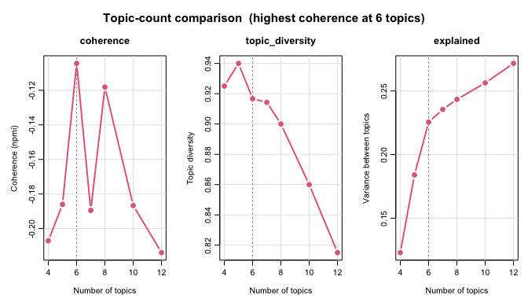{fig-alt="Topic-count comparison plots"}

[SWORD](https://cran.r-project.org/package=SWORD) v0.1.0: Implements SWORD (Support vector machine Weighted Oblique Random Decision forests), a random forest method for regression based on TORS (Tree Oblique for Regression with weighted SVM) oblique regression trees. At each internal node a Weighted-SVM classifier with a linear kernel defines the oblique splitting hyperplane as a sparse linear combination of predictors. The `C++` coordinate-descent solver provides fast training. The TORS algorithm is described in [Carta and Frigau (2025)](doi:10.1007/s00180-025-01647-w). The weighted SVM is based on [Yang, Song and Cao (2005)](doi:10.1109/IJCNN.2005.1555965) and the `WeightSVM` package. See the [vignette](https://cran.r-project.org/web/packages/SWORD/vignettes/intro-sword.html)

{fig-alt="SWORD decision forest"}

### Mathematics

[DistributionalDDA](https://cran.r-project.org/package=DistributionalDDA) v0.1.1: Enables statistical analysis of data sets whose observations are whole probability distributions, using Bayes space calculus. Distributions (provided as samples, histograms or density functions) are treated as elements of a Hilbert space, so that operations such as mean, variance, distance, principal component analysis and clustering carry over to densities. Reference measures defining the geometry of the space can be chosen and combined. The methodology was first published with peer review by van den [Boogaart, Egozcue and Pawlowsky-Glahn (2014)](doi:10.1111/anzs.12074). See the vignettes [How to](https://cran.r-project.org/web/packages/DistributionalDDA/vignettes/DistributionalDDA.html) and [PCA for Distributional Data](https://cran.r-project.org/web/packages/DistributionalDDA/vignettes/PCA_distributional_data.html).

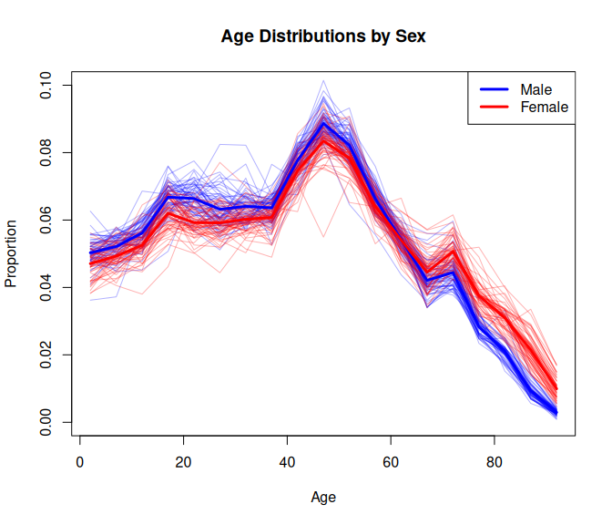{fig-alt="Plot of Distributions by Sex"}

[sundials](https://cran.r-project.org/package=sundials) v7.9.0-1: Bundles the pure-C part of the `SUNDIALS` suite (CVODE, CVODES, ARKODE, IDA, IDAS and KINSOL with the serial vector and the dense, band and iterative linear solvers) and builds it into a static library. `SUNDIALS` is described in [Hindmarsh et al. (2005)](doi:10.1145/1089014.1089020). Look [here](https://computing.llnl.gov/projects/sundials) for documentation.

:::

::: {.column width="10%"}

:::

::: {.column width="45%"}

### Medical Statistics

[mirrorslope](https://cran.r-project.org/package=mirrorslope) 0.2.1: Creates mirrored slope plots comparing two treatment arms over a single observation interval. Both arms share a common x-axis and converge at a central endpoint, making the between-arm gap the primary visual quantity. Returns standard `ggplot2` objects for full extensibility. The display was designed by Kati Maharry and was first used in the supplementary appendix of [McDonald and colleagues (2026)](doi:10.1016/S0140-6736(26)01385-1). There are three vignettes including [Introduction](https://cran.r-project.org/web/packages/mirrorslope/vignettes/introduction.html) and [Clinical workflow with ADaM data](https://cran.r-project.org/web/packages/mirrorslope/vignettes/clinical-workflow.html).

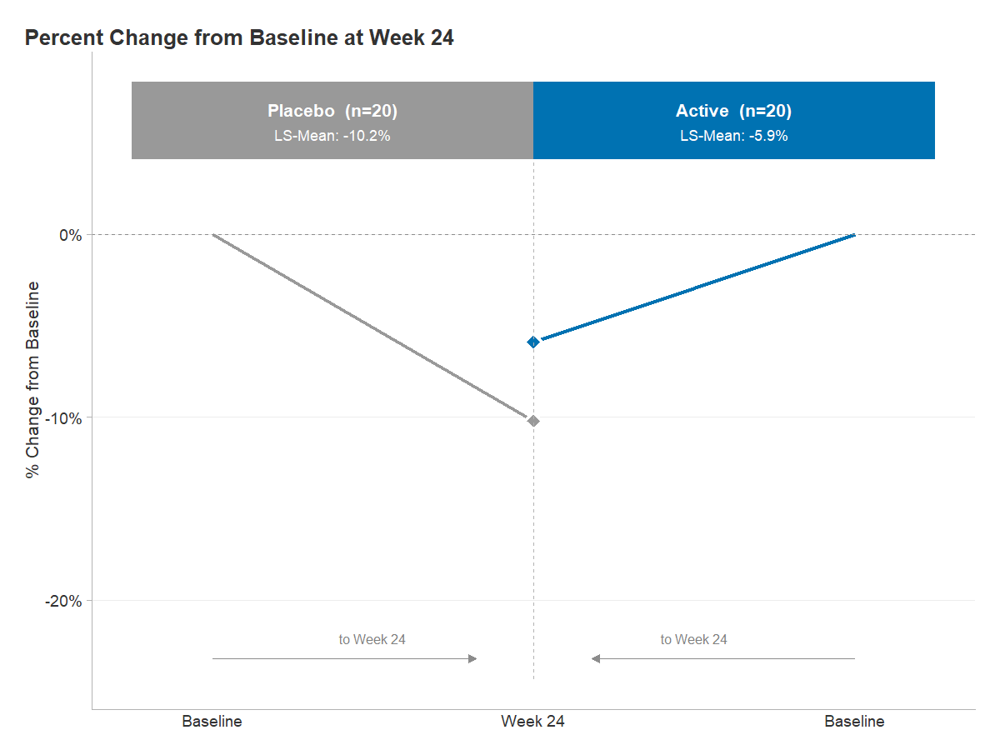{fig-alt="Example of a mirrorslope plot"}

[PDRobust](https://cran.r-project.org/package=PDRobust) v0.3.8: Implements principal-stratification methods for estimating time-specific and pooled heterogeneous treatment effects in longitudinal studies where outcomes may be truncated by death. Supports continuous and binary outcomes, explicit data validation and standardization, and covariate-dependent treatment effects. Fits propensity-score, principal-score, and outcome models and provides subject-level bootstrap inference, covariate-balance diagnostics, principal-stratum summaries, treatment-group-specific survival odds ratios, and outcome-noise sensitivity analysis. Methodological background is provided in [Zhang et al. (2006)](doi:10.48550/arXiv.2608.06654). There are seven vignettes including [Diagnostics, profiling, and sensitivity analysis](https://cran.r-project.org/web/packages/PDRobust/vignettes/diagnostics-profiling-sensitivity.html) and [Treatment coding and interpretation](https://cran.r-project.org/web/packages/PDRobust/vignettes/method-and-coding.html).

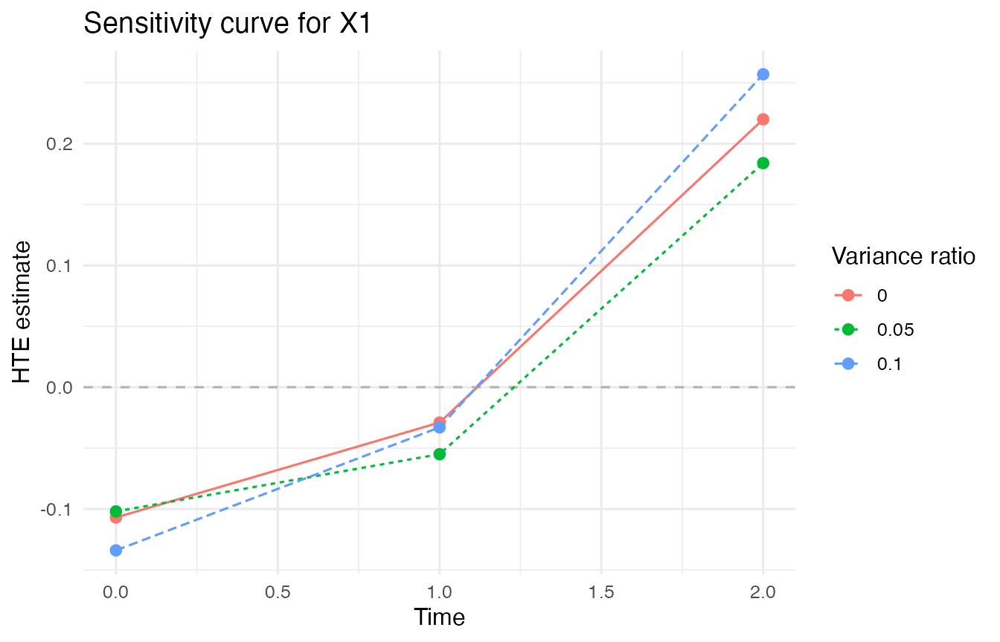{fig-alt="Sensitivity cuves"}

[PheValuator](https://cran.r-project.org/package=PheValuator) v2.2.19: Evaluates phenotype algorithms by developing a diagnostic prediction model using a set of noisy positives and noisy negatives. It can then apply the model to a large cohort to create a set of subjects each with a predicted probability for the health outcome of interest. This cohort can then be used to evaluate phenotype algorithms through the calculation of the necessary performance characteristics: sensitivity, specificity, and positive and negative predictive value. Based on work by [Swerdel (2022)](doi:10.1016/j.jbi.2022.104177) and [Swerdel (2019)](doi:10.1016/j.jbi.2019.103258). See the [vignette](https://cran.r-project.org/web/packages/PheValuator/vignettes/EvaluatingPhenotypeAlgorithms.pdf).

### Probability

[BiasedMatch](https://cran.r-project.org/package=BiasedMatch) v0.1.0: Provides tools for the two-urn biased sampling problems of [Puza and Bonfrer (2018)](doi:10.1080/03610926.2017.1300282). Two overlapping sets of items are sampled without replacement, with items common to both sets given a selection weight favoring their inclusion. Functions compute the probability mass function, mean and variance of the number of matching items using the univariate and bivariate Wallenius' non-central hypergeometric distributions, perform maximum likelihood and Bayesian inference for the bias parameter, and provide Metropolis-Hastings algorithms for hierarchical extensions. See the [vignette](https://cran.r-project.org/web/packages/BiasedMatch/vignettes/biasedmatch.html).

### Public Health

[mudnester](https://cran.r-project.org/package=mudnester) v0.7.8: Clean, prepare, and aggregate surveillance data for public health analysis. Provides structural data cleaning and standardization, age categorization against ~50 published schemes with publication-ready labeling, time-unit aggregation with zero-filling and seasonal awareness, joint aggregation of several linked event dates into one table of comparable rate columns, under-ascertainment correction via a stratified, time-varying multiplier factor supplied directly, comorbidity detection from ICD-10-AM clinical coding, vaccine coverage data construction, hash-based de-identification, and relinking of previously de-identified data. Built for Australian public health surveillance practice but not specific to it. There are eleven vignettes including [Getting starte](https://cran.r-project.org/web/packages/mudnester/vignettes/mudnester-getting-started.html) and [Vaccine Coverage Data Structures](https://cran.r-project.org/web/packages/mudnester/vignettes/brood.html).

### Statistics

[ballast](https://cran.r-project.org/package=ballast) v0.7.4: Refits one pre-specified mixed model for repeated measures under families of data and analytic perturbations  and judges every refit against the pre-specified estimate, confidence interval and p-value. Classifies the result as robust, sensitive or fragile, with a separate flag for marginal significance, and estimates by simulating the probability that a planned design gives a significant and robust result. Fitting uses `mmrm` with `SAS` `PROC MIXED` conventions for the least-squares-mean contrast, Kenward-Roger adjustment and the corrected Akaike criterion. Reference-based multiple imputation follows [Carpenter, Roger and Kenward (2013)](doi:10.1080/10543406.2013.8349110) and was checked against `rbmi` [Gower-Page, Noci and Wolbers (2022)](doi:10.21105/joss.04251). There are six vignettes including [Quickstart](https://cran.r-project.org/web/packages/ballast/vignettes/quickstart.html) and [Interpreting the verdict](https://cran.r-project.org/web/packages/ballast/vignettes/interpreting.html).

[bartisan](https://cran.r-project.org/package=bartisan) v0.1.0: Fits Bayesian additive regression trees (BART) models for likelihoods outside the conditionally conjugate Gaussian case using the Laplace-approximation reversible-jump sampler of [Linero (2025)](doi:10.1080/01621459.2024.2337156). Supported response families include Gaussian, binomial, Poisson, negative binomial, gamma, beta, ordered beta, ordinal, multinomial, zero-inflated counts, a Tweedie compound Poisson for a non-negative response with a point mass at zero, accelerated failure time and proportional hazards models for right-censored survival data, location-scale regression, and a Dirichlet process mixture for the error distribution. Decision rules may be hard, as in standard BART, or soft, as in the SoftBart model of [Linero and Yang (2018)](doi:10.1111/rssb.12293), which yields smoother fits. There are eleven vignettes including [Getting Started](https://cran.r-project.org/web/packages/bartisan/vignettes/bartisan.html) and [Generalized BART](https://cran.r-project.org/web/packages/bartisan/vignettes/implementation.html).

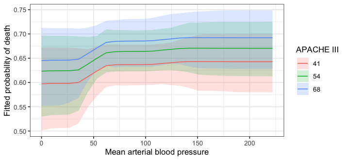{fig-alt="Plot P(death) vs Mean arterial BP"}

[INLAcircular](https://cran.r-project.org/package=INLAcircular) v1.0.0: Provides a Bayesian regression framework for joint models with circular responses and covariates using integrated nested Laplace approximations, following [Ye, Van Niekerk and Rue (2026)](doi:10.48550/arXiv.2602.08413). The package supports link-adjusted von Mises likelihoods, shared latent predictors, structured latent effects, and optional LKJ-based multivariate covariance models. It also provides compiled circular densities and d/p/q/r penalized-complexity priors for von Mises, cardioid, and wrapped Cauchy concentration parameters as developed by [Ye, Van Niekerk and Rue (2026)](doi:10.1177/1471082X261453677). See the [vignette](https://cran.r-project.org/web/packages/INLAcircular/vignettes/INLAcircular-guide.html).

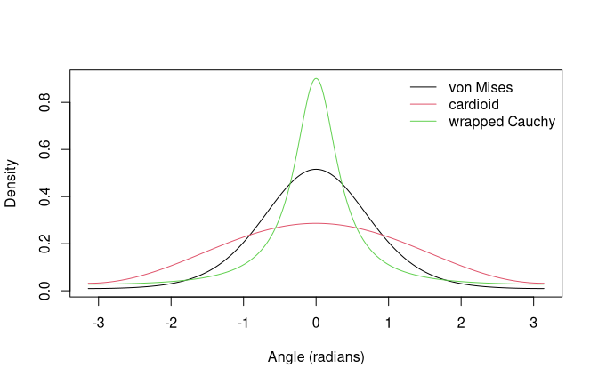{fig-alt="Plot of 3 circular density families with mean direction 0"}

[lande](https://cran.r-project.org/package=lande) v0.1.0: Estimates selection differentials and linear, quadratic and correlational selection gradients on relative fitness following [Lande and Arnold (1983)](doi:10.1111/j.1558-5646.1983.tb00236.x), with p-values from the logistic model for survival and from a Poisson or negative binomial model for counts. Fits cubic spline fitness functions as in [Schluter (1988)](doi:10.1111/j.1558-5646.1988.tb02507.x) and two-trait fitness surfaces drawn only where there are data, and computes adaptive landscapes of mean fitness against the population mean for one or two traits, by period and for several groups on one surface. Includes bootstrap intervals, a combined results table and a `Shiny` app. See the [vignette](https://cran.r-project.org/web/packages/lande/vignettes/evolutionary-selection-analysis.html).

{fig-alt="Plot of a correlated fitness surface"}

[lassoinf](https://cran.r-project.org/package=lassoinf) v0.1.0: Provides confidence intervals and p-values for parameters chosen by the randomized lasso. Implements the polyhedral approach of [Lee et al. (2016)](doi:10.1214/15-AOS1371), the randomized response of [Tian and Taylor (2018)](doi:10.1214/17-AOS1564) and the exact randomized inference of [Panigrahi, Fry and Taylor (2024)](doi:10.1093/biomet/asae019), with the truncated bivariate normal computations of [Liu (2023)](doi:10.48550/arXiv.2308.10346). Includes inference for user-specified estimands, screening of inactive variables and problems fitted by `glmnet`. Computations use a `C++` backend with matrix-free linear operators for wide designs. There are five vignettes including [Randomized LASSO](https://cran.r-project.org/web/packages/lassoinf/vignettes/gaussian_lasso.html) and [Inference after a glmnet fit](https://cran.r-project.org/web/packages/lassoinf/vignettes/glmnet_logistic.html).

[latents](https://cran.r-project.org/package=latents) v1.1.9: Fits single-level and multilevel latent profile and class models, latent transition models, and mixture regression and growth models for studying unobserved heterogeneity. Accommodates continuous, categorical, ordinal, count and mixed indicators. Provides model comparison, parameter inference, classification diagnostics and graphical summaries. Observed-data likelihood methods are available for incomplete indicators, and supported transition models can be represented as networks using the `tna` package. The multilevel latent class formulation follows [Vermunt (2003)](doi:10.1111/j.0081-1750.2003.t01-1-00131.x). See the vignettes [Two-level latent class analysis](https://cran.r-project.org/web/packages/latents/vignettes/lca.html) and [Multilevel latent profile analysis](https://cran.r-project.org/web/packages/latents/vignettes/lpa.html).

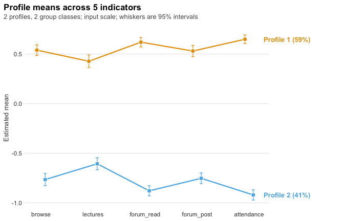{fig-alt="Plot of profile means across 5 indicators"}

[metamixr](https://cran.r-project.org/package=metamixr) v0.1.0: Fits Bayesian random-effects meta-analytic mixture models in which the true study effects are drawn from a mixture of normal components with component-specific means and between-study heterogeneity. The mixture model can be combined with step-function selection models as in [Vevea and Hedges (1995)](doi:10.1007/BF02294384) to adjust for publication bias. Models are estimated by Hamiltonian Monte Carlo using `rstan`. Posterior summaries, posterior predictive checks and marginal likelihoods for model comparison are returned as `stanfit` objects. Also includes a data simulator and the nudging meta-analysis data of [Mertens et al. (2022)](doi:10.1073/pnas.2107346118). There are four vignettes including [Getting started](https://cran.r-project.org/web/packages/metamixr/vignettes/metamix.html) and [Application to Nudging](https://cran.r-project.org/web/packages/metamixr/vignettes/nudging.html).

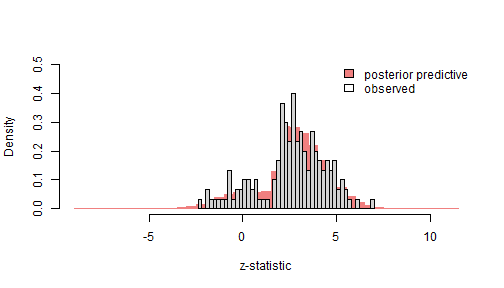{fig-alt="Comparison of posterior predictive and observed distributions"}

[proxymix](https://cran.r-project.org/package=proxymix) v0.17.0: Fits multivariate Gaussian-mixture proxies to target distributions on real Euclidean space, given by a density, by samples, or by a characteristic function. Four fitting regimes are unified: (i) closed-form moment matching for a single component, (ii) classical expectation-maximisation when independent samples are available, (iii) importance-sampled expectation-maximisation that minimizes the Kullback-Leibler divergence and (iv) a least-squares fit to the characteristic function. Provides numerical bounds on the Kolmogorov distance along one-dimensional projections. Implements the regime hierarchy of [van der Hoek and Elliott (2024)](doi:10.1080/07362994.2024.2372605). There are thirteen vignettes including [The closed-form operator calculus on a mixture](https://cran.r-project.org/web/packages/proxymix/vignettes/operator_calculus.html) and [How well a mixture proxies four awkward shapes](https://cran.r-project.org/web/packages/proxymix/vignettes/density_shapes.html).

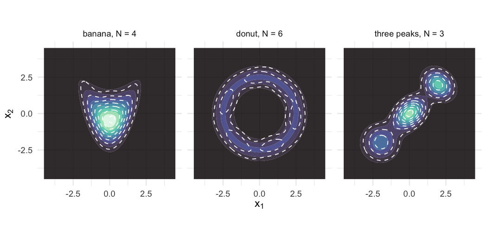{fig-alt="Plots of target shapes with fitted proxy contours"}

[radiatR](https://cran.r-project.org/package=radiatR) v0.1.3: Implements a complete pipeline for analyzing directional data, headings and trajectories on the unit disk. Supply a table of angles directly, or reconstruct headings from movement trajectories imported from tracking tools via a unified dialect-based loader system, including multi-bodypart pose estimation with likelihood-weighted centroid. Computes circular statistics including mean direction, resultant length, von Mises and wrapped Cauchy parametric fits, circular correlation, circular-linear regression. See [Fisher and Lee (1992)](doi:10.2307/2532334), [Fitak and Johnsen (2017)](doi:10.1242/jeb.167056), and [Landler et al.(2019)](doi:10.1186/s12898-019-0246-8) for background. There are five vignettes including [Circular Statistics and Distribution Overlays](https://cran.r-project.org/web/packages/radiatR/vignettes/circular-statistics.html) and [Guide for AI agents](https://cran.r-project.org/web/packages/radiatR/vignettes/agent-guide.html) and the `Shiny` app.

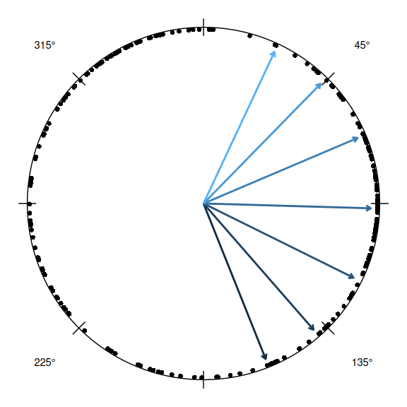{fig-alt="Circular statistics plot"}

[spifa](https://cran.r-project.org/package=spifa) v0.1.0: Fits spatial item factor analysis models for binary responses, following [Chacón-Montalván et al. (2025)](doi:10.1214/25-AOAS2072), using full Bayesian inference via adaptive Metropolis-Hastings within Gibbs sampling and auxiliary variables with a probit link function. Latent factors are modeled as the sum of a predictor effect, a multivariate Gaussian process capturing spatial dependence, and a multivariate non-spatial term. Standard exploratory and confirmatory item factor analysis are supported as particular cases. There are five vignettes including [Introduction](https://cran.r-project.org/web/packages/spifa/vignettes/spifa.html) and [Advanced Features](https://cran.r-project.org/web/packages/spifa/vignettes/vg03-advanced-features.html).

{fig-alt="Plot of traces and factor distributions"}

### Time Series

[foresightr](https://cran.r-project.org/package=foresightr) v0.1.1: Implements time series forecasting via a rolling-origin backtest in [Tashman (2000)](doi:10.1016/S0169-2070(00)00065-0) which refits every candidate at each origin using out-of-sample error. Prediction intervals are quantiles of the errors actually observed, for each horizon and for totals of the next periods. Models include seasonal ARIMA by exact maximum likelihood with automatic orders, [Hyndman and Khandakar (2008)](doi:10.18637/jss.v027.i03); exponential smoothing in state space form, [Hyndman, Koehler, Snyder and Grose (2002)](doi:10.1016/S0169-2070(01)00110-8); the Theta method,  [Assimakopoulos and Nikolopoulos (2000)](doi:10.1016/S0169-2070(00)00066-2) and more.  The computations are done by the `Rust` crate `foresight`, bundled with the package. There are five vignettes including [Get started](https://cran.r-project.org/web/packages/foresightr/vignettes/foresightr.html) and [The Backtest and its intervals](https://cran.r-project.org/web/packages/foresightr/vignettes/backtest.html).

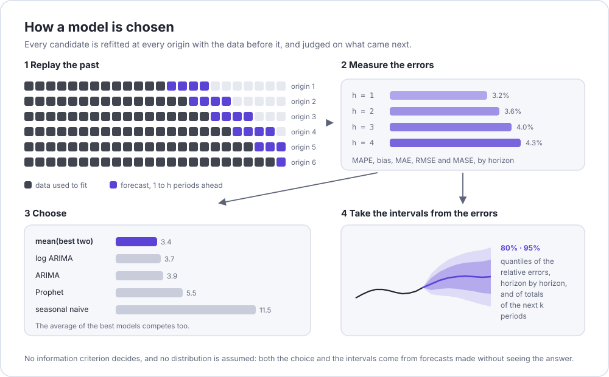{fig-alt="Diagram illustrating how a model is chosen"}

[rjd3highfreq](https://cran.r-project.org/package=rjd3highfreq) v3.0.1: Implements an `R` interface to [JDemetra+ 3.x](https://github.com/jdemetra), the time series analysis software which provides functions for seasonal adjustment of higher-frequency data, including those with multiple or non-integer periodicities. It includes pre-adjustment via the extended airline model and several seasonal decomposition methods: extended airline model based decomposition, extended X-11, and augmented STL. See the [vignette](https://cran.r-project.org/web/packages/rjd3highfreq/vignettes/X11.html).

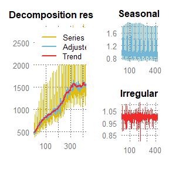{fig-alt="Seasonal decomposition"}

### Utilities

[controlledburn](https://cran.r-project.org/package=controlledburn) v0.3.2: Rasterize polygon, line, and point geometry without materializing any pixel values. For polygons compute exact coverage fractions for polygon-grid intersections, returning sparse tables: run-length encoded interior cells and individually weighted boundary cells. The scanline algorithm is O(perimeter) in both time and memory using the scan line fill attributed to [Wylie et al. (1967)](doi:10.1145/1465611.1465619). Exact coverage fractions use the exactextract algorithm from the `exactextractr` `fasterize` packages. See the vignettes[Algorithms](https://cran.r-project.org/web/packages/controlledburn/vignettes/algorithms.html) and [Architecture](https://cran.r-project.org/web/packages/controlledburn/vignettes/architecture.html).

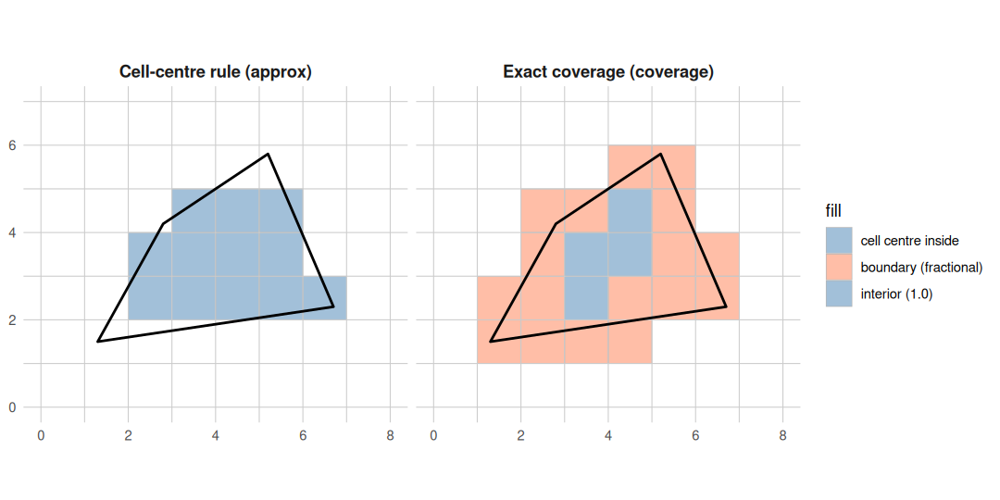{fig-alt="Polygon under teo different classification schemes"}

[irelink](https://cran.r-project.org/package=irelink) v0.0.2: Performs fast, scalable probabilistic record linkage and deduplication using the [Fellegi-Sunter model](https://en.wikipedia.org/wiki/Record_linkage). Records lacking a shared unique identifier are compared across configurable dimensions using exact, fuzzy, and distance-based comparisons, with model parameters estimated via unsupervised Expectation-Maximization. Multiple `SQL` backends are supported through `DBI`, including execution via `DuckDB`. This package is a translation of the `Python` `splink` library by [Linacre et al. (2022)](doi:10.23889/ijpds.v7i3.1794) into idiomatic `R`. There are six vignettes including [Getting Started](https://cran.r-project.org/web/packages/irelink/vignettes/irelink.html) and 
[Record Linkage Across Datasets](https://cran.r-project.org/web/packages/irelink/vignettes/record-linkage.html).

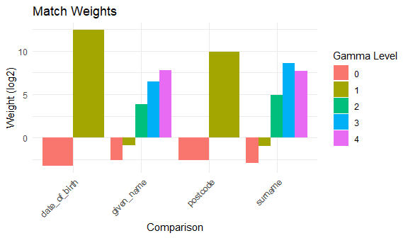{fig-alt="Plot of match weights for a link-type model"}

[seqbench](https://cran.r-project.org/package=seqbench) v0.1.0: Provides sequential, anytime-valid comparison of algorithms on paired losses with a practical-equivalence margin, confidence sequences for the mean paired difference, superiority/equivalence/continue decisions, cost accounting and auditable trajectories. See the [vignette](https://cran.r-project.org/web/packages/seqbench/vignettes/getting-started.html)
.

### Visualization

[ggfourfold](https://cran.r-project.org/package=ggfourfold) v0.1.0: Draws fourfold displays of 2 x 2 (x k) contingency tables as a `ggplot2` layer, following [Friendly (1994)](https://datavis.ca/papers/4fold/4fold.pdf) and [Friendly and Meyer (2016)](doi:10.1201/9781315374413). Cell frequencies are shown as quarter-circles or squares of proportional area, with confidence rings for the odds ratio and shading for the direction and strength of association. See the [vignette](https://cran.r-project.org/web/packages/ggfourfold/vignettes/ggfourfold.html).

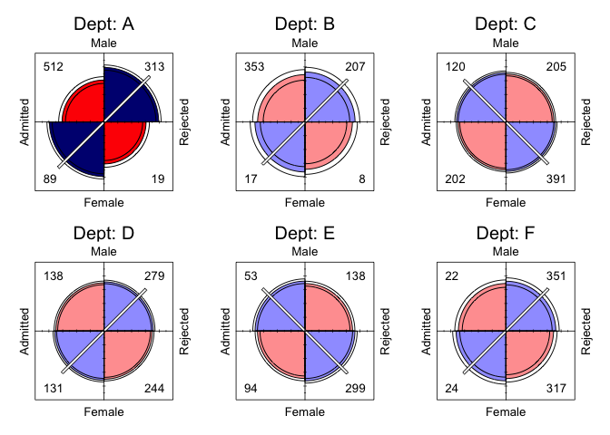{fig-alt="Examples of four-fold plots"}

:::

::::
