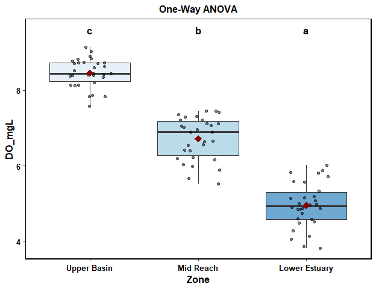
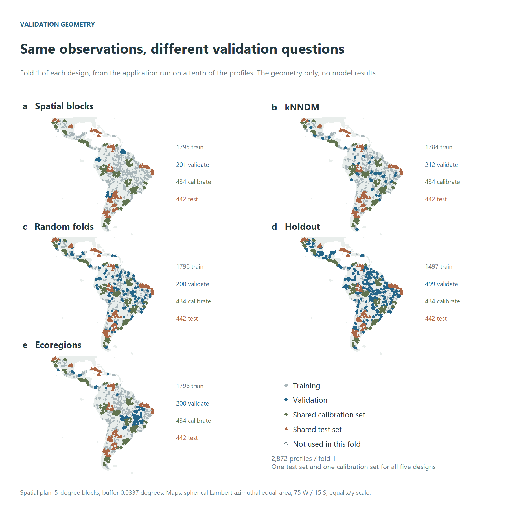
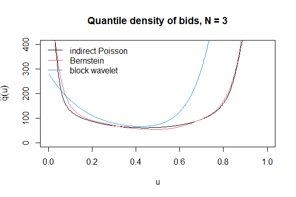
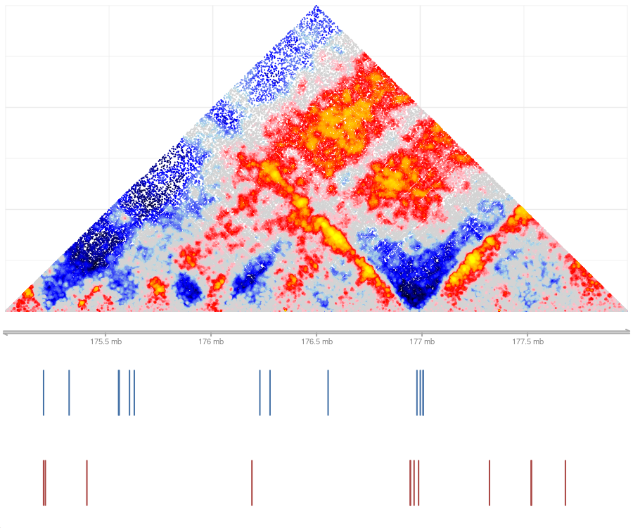
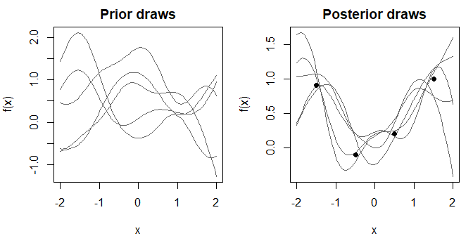
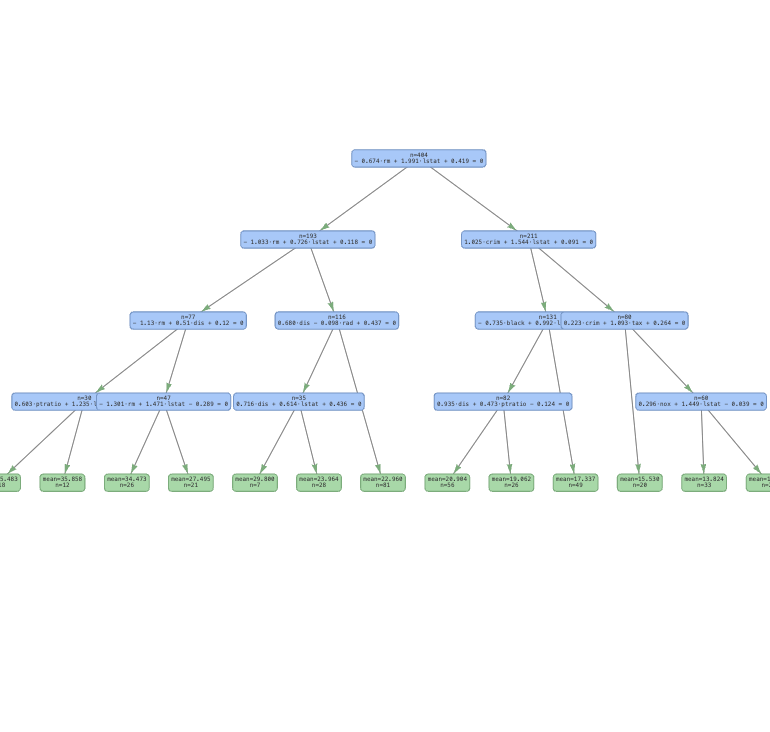
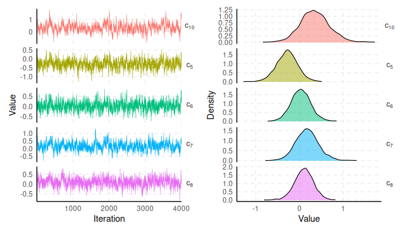

{fig-alt=""}

:::: {.columns}

::: {.column width="45%"}

### Agriculture

### Environmental Studies

[EnvRtype](https://cran.r-project.org/package=EnvRtype) 0.1.3: Provides an enviromics toolkit for genotype-by-environment analysis and envirotype-informed genomic prediction. Collects worldwide daily and hourly weather data, soil profiles, elevation and bioclimatic layers data, agro-ecological zone data, and downscaled climate scenarios, with checkpointed retrieval that can resume after an interrupted run. Derives agro-meteorological parameters and maps daily weather onto crop developmental stages. Fits Bayesian reaction-norm kernel models and predicts trained genotypes at untested locations and planting dates, with coverage diagnostics, spatial mapping and planting-window optimisation. Methods are described in [Costa-Neto et al. (2021)](doi:10.1093/g3journal/jkab040), and build on the Bayesian genotype-by-environment kernel sampler of [Granato et al(2018)](doi:10.1534/g3.118.200435). See the [vignette](https://cran.r-project.org/web/packages/EnvRtype/vignettes/EnvRtype.html).

{fig-alt="Heat map of correlation among environmental incdices"}

[ET0MassModels](https://cran.r-project.org/package=ET0MassModels) v1.0.0: Provides functions to estimate daily reference evapotranspiration  using 10 mass transfer-based empirical models, with the Food and Agriculture Organization Penman-Monteith method included as the standard reference for model comparison. Includes statistical evaluation metrics, such as Nash-Sutcliffe efficiency, root mean square error, mean absolute error, and mean bias error, and visualization tools. Based on [Singh et al. (2026)](doi:10.1016/j.ejrh.2026.103925). See the [vignette](https://cran.r-project.org/web/packages/ET0MassModels/vignettes/introduction.html).

{fig-alt="Taylor diagram - Mass Transfer-Based Models"}

### Ecology

[aquats](https://cran.r-project.org/package=aquats) v1.2.2: Implements a comprehensive statistical and visualization toolkit tailored for  observational data in fisheries science and aquatic ecology. Provides ANOVA, ANCOVA, MANOVA, permutational multivariate analysis of variance, similarity percentages, generalized linear models, non-linear morphometric regressions, two-group hypothesis testing, and chi-square tests. Methodological formulations for multivariate permutation tests follow [Anderson (2001)](oi:10.1111/j.1442-9993.2001.01070.pp.x) Ecological community dissimilarity transformations follow [Legendre and Gallagher (2001)](doi:10.1007/s004420100716), and ecotoxicological contamination index models follow [Tomlinson et al. (1980)](doi:10.1007/BF02414780). See the [vignette](https://cran.r-project.org/web/packages/aquats/vignettes/aquats-tutorial.html) for examples.

{fig-alt="ANOVA plots"}

[soilcnn](https://cran.r-project.org/package=soilcnn) v0.1.0: Implements a framework, built on `torch`, for mapping a soil property from point observations and a stack of aligned rasters with a convolutional network that reads the neighbourhood of each point. It extracts the patches; resamples by spatial blocks or by k-fold nearest neighbour distance matching, after [Linnenbrink et al. (2024)](doi:10.5194/gmd-17-5897-2024); tunes and selects under a noise floor and the one-standard-error rule; refits the selected configuration under several seeds; and predicts median, mean and interval maps over rasters of any extent. The map's centre is the ensemble median over seeds; the mean corrects its back-transformation by smearing, after [Duan (1983)](doi:10.1080/01621459.1983.10478017). See the [vignette](https://cran.r-project.org/web/packages/soilcnn/vignettes/soilcnn.html) to get started.

{fig-alt="Plot illustrating validation geometry"}

### Epidemiology

[epidist](https://cran.r-project.org/package=epidist) v1.0.0: Provides methods to address the key challenges in estimating epidemiological delay distributions which influence epidemic situational awareness, control strategies, and resource allocation. Includes truncation, interval censoring, and dynamical biases, following [Park et al. (2024)](doi:10.1101/2024.01.12.24301247) and [Charniga et al. (2024)](doi:10.1371/journal.pcbi.1012520). Built on top of `brms`, functions allow for flexible modelling including time-varying and spatial effects and partially pooled estimates of demographic characteristics. There arenine vignettes including [Getting started](https://cran.r-project.org/web/packages/epidist/vignettes/epidist.html) and [Model Guide](https://cran.r-project.org/web/packages/epidist/vignettes/model.html).

{fig-alt="Plots of true value and estimates distributions"}

### Finance

[qdfauction](https://cran.r-project.org/package=qdfauction) v0.3.0: Provides nonparametric estimators of the quantile density function: kernel, boundary-corrected kernel, Poisson-weight and Bernstein-polynomial smoothers, indirect estimators, and linear, hard-thresholded and block-thresholded wavelet estimators with smoothing parameters chosen by biased, robust likelihood or least-squares cross-validation. The estimators are applied to the structural analysis of first-price sealed-bid auctions: recovery of private values for independent or affiliated values and risk-neutral or risk-averse bidders. See [Jones (1992)](https://www.ism.ac.jp/editsec/aism/pdf/044_4_0721.pdf), [Soni, Dewan and Jain (2012)](doi:10.1016/j.csda.2012.04.014), and [Chaubey, Dewan and Li (2024)](doi:10.1080/03610926.2023.2222922) for background and the [vignette](https://cran.r-project.org/web/packages/qdfauction/vignettes/timber.html) for examples.

{fig-alt="Plot of quantile estimates of bids"}

### Genomics

[shaman](https://cran.r-project.org/package=shaman) v2.1.1: Generate expected Hi-C (genome-wide chromosome conformation capture) data maintaining marginal coverage, and the decay in contact probability with increasing genomic distance. Expected Hi-C data is used for normalization and graphical presentation of statistical significance of observed Hi-C contact enrichments. The method is described in [Mendelson Cohen et al. (2017)](doi:10.1101/187203). See the vignettes [Sampling HiC contAct Matrices for Aparametric Normalization](https://cran.r-project.org/web/packages/shaman/vignettes/shaman-package.html)] and [Import]().

{fig-alt="visualization of region with scores against hic_exp from shaman_score_hic_mat()"}

### Machine Learning

[gaussianprocesses](https://cran.r-project.org/package=gaussianprocesses) v1.0.0: Gaussian process regression, classification, and count models with explicit covariance kernels, exact Gaussian inference, Laplace approximations for non-Gaussian likelihoods, sparse approximations, marginal-likelihood optimization, derivatives, posterior sampling, calibration diagnostics, and time-series workflows. The implementation follows the core methodology of [Rasmussen and Williams (2006)](doi:10.7551/mitpress/3206.001.0001) and emphasizes numerical stability, transparent assumptions, and reproducible statistical workflows. There are seven vignettes including [Gaussian-Process Regression from First Principles](https://cran.r-project.org/web/packages/gaussianprocesses/vignettes/v01-gp-regression.html) and [Gaussian Processes for Time Series](https://cran.r-project.org/web/packages/gaussianprocesses/vignettes/v06-time-series.html).

{fig-alt="Prior and posterior draws for GP regression"}

[SWORD](https://cran.r-project.org/package=SWORD) v0.1.0: Implements SWORD (Support vector machine Weighted Oblique Random Decision forests), a random forest method for regression based on TORS (Tree Oblique for Regression with weighted SVM) oblique regression trees. At each internal node a Weighted-SVM classifier with a linear kernel defines the oblique splitting hyperplane as a sparse linear combination of predictors. The `C++` coordinate-descent solver provides fast training. The TORS algorithm is described in [Carta and Frigau (2025)](doi:10.1007/s00180-025-01647-w). The weighted SVM is based on [Yang, Song and Cao (2005)](doi:10.1109/IJCNN.2005.1555965) and the `WeightSVM` package. See the [vignette](https://cran.r-project.org/web/packages/SWORD/vignettes/intro-sword.html)

{fig-alt=" SWORD decision forest"}

### Mathematics

[sundials](https://cran.r-project.org/package=sundials) v7.9.0-1: Bundles the pure-C part of the `SUNDIALS` suite (CVODE, CVODES, ARKODE, IDA, IDAS and KINSOL with the serial vector and the dense, band and iterative linear solvers) and builds it into a static library. `SUNDIALS` is described in [Hindmarsh et al. (2005)](doi:10.1145/1089014.1089020). Look [here](https://computing.llnl.gov/projects/sundials) for documentation.

### Medical Statistics

:::

::: {.column width="10%"}

:::

::: {.column width="45%"}

### Networks

### Probability

[BiasedMatch](https://cran.r-project.org/package=BiasedMatch) v0.1.0: Provides tools for the two-urn biased sampling problems of [Puza and Bonfrer (2018)](doi:10.1080/03610926.2017.1300282). Two overlapping sets of items are sampled without replacement, with items common to both sets given a selection weight favouring their inclusion. Functions compute the probability mass function, mean and variance of the number of matching items using the univariate and bivariate Wallenius' non-central hypergeometric distributions, perform maximum likelihood and Bayesian inference for the bias parameter, and provide Metropolis-Hastings algorithms for hierarchical extensions. See the [vignette](https://cran.r-project.org/web/packages/BiasedMatch/vignettes/biasedmatch.html).

### Statistics

[ballast](https://cran.r-project.org/package=ballast) v0.7.4: Refits one pre-specified mixed model for repeated measures under families of data and analytic perturbations  and judges every refit against the pre-specified estimate, confidence interval and p-value. Classifies the result as robust, sensitive or fragile, with a separate flag for marginal significance, and estimates by simulation the probability that a planned design gives a significant and robust result. Fitting uses `mmrm` with `SAS` `PROC MIXED` conventions for the least-squares-mean contrast, Kenward-Roger adjustment and the corrected Akaike criterion. Reference-based multiple imputation follows [Carpenter, Roger and Kenward (2013)](doi:10.1080/10543406.2013.8349110 and was checked against `rbmi` [Gower-Page, Noci and Wolbers (2022)](doi:10.21105/joss.04251). There are six vignettes including [Quickstart](https://cran.r-project.org/web/packages/ballast/vignettes/quickstart.html) and [Interpreting the verdict](https://cran.r-project.org/web/packages/ballast/vignettes/interpreting.html).

[lande](https://cran.r-project.org/package=lande) v0.1.0: Estimates selection differentials and linear, quadratic and correlational selection gradients on relative fitness following [Lande and Arnold (1983)](doi:10.1111/j.1558-5646.1983.tb00236.x), with p-values from the logistic model for survival and from a Poisson or negative binomial model for counts. Fits cubic spline fitness functions as in [Schluter (1988)](doi:10.1111/j.1558-5646.1988.tb02507.x) and two-trait fitness surfaces drawn only where there are data, and computes adaptive landscapes of mean fitness against the population mean for one or two traits, by period and for several groups on one surface. Includes bootstrap intervals, a combined results table and a `Shiny` app. See the [vignette](https://cran.r-project.org/web/packages/lande/vignettes/evolutionary-selection-analysis.html).

{fig-alt="Plot of a correlated fitness surface"}

[lassoinf](https://cran.r-project.org/package=lassoinf) v0.1.0: Provides onfidence intervals and p-values for parameters chosen by the randomized)lasso, valid after selection. Implements the polyhedral approach of [Lee et al. (2016)](doi:10.1214/15-AOS1371), the randomized response of [Tian and Taylor (2018)](doi:10.1214/17-AOS1564) and the exact randomized inference of [Panigrahi, Fry and Taylor (2024)](doi:10.1093/biomet/asae019), with the truncated bivariate normal computations of [Liu (2023)](doi:10.48550/arXiv.2308.10346). Includes inference for user-specified estimands, screening of inactive variables and problems fitted by `glmnet`. Computations use a `C++` backend with matrix-free linear operators for wide designs. There are five vignettes including [Randomized LASSO](https://cran.r-project.org/web/packages/lassoinf/vignettes/gaussian_lasso.html) and [Inference after a glmnet fit](https://cran.r-project.org/web/packages/lassoinf/vignettes/glmnet_logistic.html).

[radiatR](https://cran.r-project.org/package=radiatR) v0.1.3: Implements a complete pipeline for analysing directional data, headings and trajectories on the unit disk. Supply a table of angles directly, or reconstruct headings from movement trajectories imported from tracking tools via a unified dialect-based loader system, including multi-bodypart pose estimation with likelihood-weighted centroid. Computes circular statistics including mean direction, resultant length, von Mises and wrapped Cauchy parametric fits, circular correlation, circular-linear regression. See [Fisher and Lee (1992)](doi:10.2307/2532334), [Fitak and Johnsen (2017)](doi:10.1242/jeb.167056), and [Landler et al.(2019)](doi:10.1186/s12898-019-0246-8) for background. There are five vignettes including [Circular Statistics and Distribution Overlays](https://cran.r-project.org/web/packages/radiatR/vignettes/circular-statistics.html) and [Guide for AI agents](https://cran.r-project.org/web/packages/radiatR/vignettes/agent-guide.html) as well as a `Shiny` app.

{fig-alt="Circular statistics plot"}

[spifa](https://cran.r-project.org/package=spifa) v0.1.0: Fits spatial item factor analysis models for binary responses, following [Chacón-Montalván et al. (2025)](doi:10.1214/25-AOAS2072), using full Bayesian inference via adaptive Metropolis-Hastings within Gibbs sampling and auxiliary variables with a probit link function. Latent factors are modelled as the sum of a predictor effect, a multivariate Gaussian process capturing spatial dependence, and a multivariate non-spatial term. Standard exploratory and confirmatory item factor analysis are supported as particular cases. There are five vignettes including [an Introduction](https://cran.r-project.org/web/packages/spifa/vignettes/spifa.html) and [Advanced Features](https://cran.r-project.org/web/packages/spifa/vignettes/vg03-advanced-features.html).

{fig-alt="Plot of traces and factor distributions"}

### Time Series

[foresightr](https://cran.r-project.org/package=foresightr) v0.1.1: Implements time series forecasting via a rolling-origin backtest, [Tashman (2000)](doi:10.1016/S0169-2070(00)00065-0) which refits every candidate at each origin using out-of-sample error. Prediction intervals are quantiles of the errors actually observed, for each horizon and for totals of the next periods. Models include seasonal ARIMA by exact maximum likelihood with automatic orders, [Hyndman and Khandakar (2008)](doi:10.18637/jss.v027.i03); exponential smoothing in state space form, [Hyndman, Koehler, Snyder and Grose (2002)](doi:10.1016/S0169-2070(01)00110-8); the Theta method,  [Assimakopoulos and Nikolopoulos (2000)](doi:10.1016/S0169-2070(00)00066-2) and more.  The computations are done by the `Rust` crate `foresight`, bundled with the package. There are five vignettes including [Get started](https://cran.r-project.org/web/packages/foresightr/vignettes/foresightr.html) and [The Backtest and its intervals](https://cran.r-project.org/web/packages/foresightr/vignettes/backtest.html).

{fig-alt="Diagram illustrating how a model is chosen"}
[rjd3highfreq](https://cran.r-project.org/package=rjd3highfreq) v3.0.1: Implements an R interface to [JDemetra+ 3.x](https://github.com/jdemetra), the time series analysis software which provides functions for seasonal adjustment of higher-frequency data, including those with multiple or non-integer periodicities. It includes pre-adjustment via the extended airline model and several seasonal decomposition methods: extended airline model based decomposition, extended X-11, and augmented STL. See the [vignette](https://cran.r-project.org/web/packages/rjd3highfreq/vignettes/X11.html).

{fig-alt="Seasonal decomposition"}

### Utilities

[irelink](https://cran.r-project.org/package=irelink) v0.0.2: Performs fast, scalable probabilistic record linkage and deduplication using the Fellegi-Sunter model. Records lacking a shared unique identifier are compared across configurable dimensions using exact, fuzzy, and distance-based comparisons, with model parameters estimated via unsupervised Expectation-Maximization. Multiple `SQL` backends are supported through `DBI`, including execution via `DuckDB`. This package is a translation of the `Python` `splink` library by [Linacre et al. (2022)](doi:10.23889/ijpds.v7i3.1794) into idiomatic `R`. There are six vignettes including [Getting Started](https://cran.r-project.org/web/packages/irelink/vignettes/irelink.html) and 
[Record Linkage Across Datasets](https://cran.r-project.org/web/packages/irelink/vignettes/record-linkage.html).

{fig-alt="Plot of match weights for a link-type model"}

### Visualization

[ggfourfold](https://cran.r-project.org/package=ggfourfold) v0.1.0: Draws fourfold displays of 2 x 2 (x k) contingency tables as a `ggplot2` layer, following [Friendly (1994)](https://datavis.ca/papers/4fold/4fold.pdf) and [Friendly and Meyer (2016)](doi:10.1201/9781315374413). Cell frequencies are shown as quarter-circles or squares of proportional area, with confidence rings for the odds ratio and shading for the direction and strength of association. See the [vignette](https://cran.r-project.org/web/packages/ggfourfold/vignettes/ggfourfold.html).

{fig-alt="Examples of four-fold plots"}

END

:::

::::
