ZZZZZ new packages were submitted to CRAN in September. Here are my Top 40 picks in nineteen categories: Agriculture, Artificial Intelligence, Climate Studies, Computational Methods, Ecology, Epidemiology, Genomics, Machine Learning, Medical Statistics, Meta-Analysis, Networks, Process control, Programming, Public Transit, Statistics, Surveys, Time Series, Utilities, and Visualization.

{fig-alt=""}

:::: {.columns}

::: {.column width="45%"}

### Agriculture

[HRRI](https://cran.r-project.org/package=HRRI) v1.0.9: Provides diagnostic functions for integrating longitudinal soil, plant and microbial observations during redox disturbance and recovery. Functions calculate stoichiometric potential oxygen demand, accessible electron capacity from explicitly supplied inventories and kinetic parameters, recovery signatures, fixed-reference domain scores, and exploratory multiblock scores with observation-coverage diagnostics. For background and methods see [Sander, Hofstetter and Gorski (2015)](doi:10.1021/acs.est.5b00006), [Kluepfel et al. (2014)](https://doi.org/10.1038%2Fngeo2084), and [Thompson et al. (2006)](https://doi.org/10.1016/j.gca.2005.12.005). There are three vignettes including [HRRI: Reading the Figures — A Worked Example](https://cran.r-project.org/web/packages/HRRI/vignettes/HRRI_gallery.html) and [HRRI: Reproduce All Six Paper Figures in R](https://cran.r-project.org/web/packages/HRRI/vignettes/HRRI_paper_figures.html).

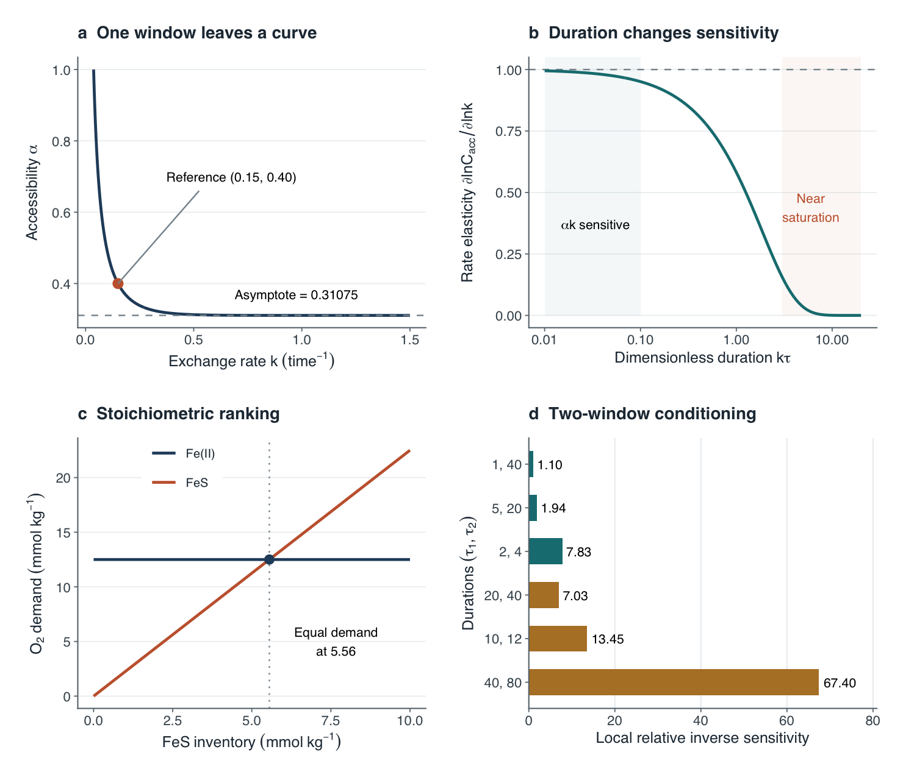{fig-alt="Plots showing identifiability, sensitivity and accounting"}

[VeraCrop](https://cran.r-project.org/package=VeraCrop) v0.1.0: Implements automated variable-type detection, preprocessing, encoding, scaling, model diagnostics, variable selection, and yield gap computation for agricultural comparative performance analysis. The comparative performance analysis approach is described in [de Bie (2004)](doi:10.1016/j.scienta.2003.11.017). For an overview of yield gap assessment methodologies, see [Kamkar et al. (2025)](doi:10.1016/j.agsy.2025.104392). See the [vignette](https://cran.r-project.org/web/packages/VeraCrop/vignettes/getting-started.html) to get started.

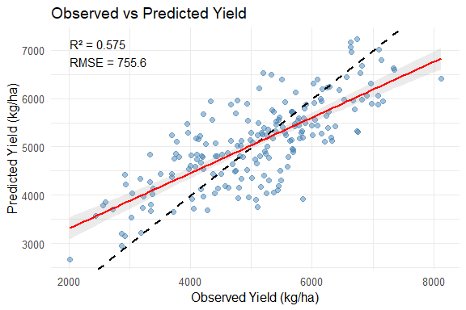{fig-alt="Plot of observed vs predicted yield"}

### Causal Inference

[phdid](https://cran.r-project.org/package=phdid) v0.1.0: In staggered difference-in-differences designs the treatment effect is a vector of cohort-time effects. Estimating each separately is unbiased but imprecise when some are equal, while pooling them all is precise but biased under genuine heterogeneity. This package treats the choice as a partition-selection problem on the cohort-time cells and provides two estimators: a Dirichlet process mixture fitted by a collapsed Gibbs sampler and an *L0*-penalised estimator that returns a single partition. Methods are described in [Arora and Wagle (2026)](doi:10.2139/ssrn.7207083). There are two vignettes [Minimum wages and teen employment: recovering partial homogeneity](https://cran.r-project.org/web/packages/phdid/vignettes/mpdta.html) and [When partial homogeneity helps, and when it does not](https://cran.r-project.org/web/packages/phdid/vignettes/simulation.html).

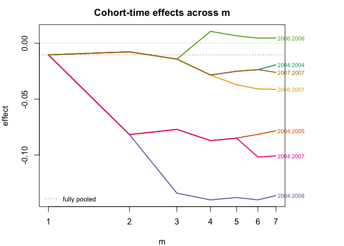{fig-alt="Plot of cohort effects"}

### Climate Studies

[xaci](https://cran.r-project.org/package=xaci) v0.1.0: Computes the Actuarial Climate Index (ACI) and its components (temperature, precipitation, drought, wind, sea level) from gridded climate data ('NetCDF') and tide gauge records. Implements the methodology described in [Garrido, Milhaud & Olympio (2025)](https://hal.science/hal-04491982v2) for a French/European actuarial climate index, building on the American Academy of Actuaries framework, to any country in the world. There are seven vignettes ncluding [Get Started](https://cran.r-project.org/web/packages/xaci/vignettes/xaci-intro.html) and [Visualizing ACI Results](https://cran.r-project.org/web/packages/xaci/vignettes/xaci-visualization.html).

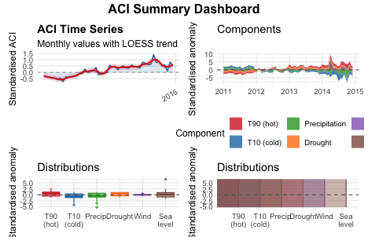{fig-alt="ACI Summary Dashboard"}

### Computational Methods

[koopman.dmd](https://cran.r-project.org/package=koopman.dmd) v0.2.2: Implements Dynamic Mode Decomposition (DMD) with Koopman operator theory extensions, powered by a Rust backend via `extendr`; standard DMD as described in [Schmid (2010)](doi:10.1017/S0022112010001217), DMD with control for forced linear systems following [Proctor, Brunton, and Kutz (2016)](doi:10.1137/15M1013857); and Extended DMD with lifting functions, Hankel-DMD via time-delay embedding, Generalized Laplace Analysis for direct eigenfunction computation, and harmonic time averages and mesochronic harmonic plots for phase space analysis as developed in [Mezic (2020)](doi:10.48550/arXiv.2009.05883). See the [vignette](https://cran.r-project.org/web/packages/koopman.dmd/vignettes/koopman-dmd.html).

[RcppTrust](https://cran.r-project.org/package=RcppTrust) v0.1.0: Implements functions for local optimization using derivatives and trust regions which are guaranteed to converge to a local minimum of the objective function. This is a thread-safe `C++` port of the algorithm in the `trust` package exposed both as a drop-in `R` function and as a `C`-callable, thread-safe entry point in a manner so it can be used from parallel `C++` code such as in `nlmixr2est`. See the [vignette](https://cran.r-project.org/web/packages/trust/vignettes/trust.pdf).

[tulpa](https://cran.r-project.org/package=tulpa) v 0.7.5: Provides a general-purpose engine for fitting Bayesian hierarchical models with spatial fields, temporal effects, spatially varying coefficients, and multiple inference backends. Scalable spatial structure includes Hilbert space approximate Gaussian processes ([Riutort-Mayol et al. (2023)](doi:10.1007/s11222-022-10167-2)), nearest-neighbor Gaussian processes ([Datta et al. (2016)](doi:10.1080/01621459.2015.1044091)), intrinsic conditional autoregressive models ([Besag, York, and Mollie (1991)](doi:10.1007/BF00116466)), the reparameterized Besag-York-Mollie model ([Riebler et al. (2016)](doi:10.1177/0962280216660421)), and stochastic partial differential equation fields ( [Lindgren, Rue, and Lindstrom (2011)](doi:10.1111/j.1467-9868.2011.00777.x)). Temporal structure covers random walks, autoregressive processes, and Gaussian processes. Inference is tiered by correctness guarantee: exact Hamiltonian Monte Carlo with the No-U-Turn sampler, Laplace and nested Laplace approximations with hyperparameter integration ([Rue, Martino, and Chopin (2009)](doi:10.1111/j.1467-9868.2008.00700.x), and variational inference. Model-specific packages plug observation likelihoods into the engine through a templated C++ callback interface. There are three vignettes including [Getting started](https://cran.r-project.org/web/packages/tulpa/vignettes/quickstart.html) and [Spatial Fields](https://cran.r-project.org/web/packages/tulpa/vignettes/spatial-models.html).

[WSwavelet](https://cran.r-project.org/package=WSwavelet) v0.1.0: Implements Bayesian wavelet denoising using a resolution-adaptive spike-and-slab prior whose continuous slab is a mixture of a compactly supported Wendland-type density and the semicircle density. Provides Gaussian and Laplace working-likelihood versions, empirical-Bayes fitting of resolution-specific slab weights, robust noise-scale estimation, posterior-mean coefficient shrinkage, reconstruction by the inverse discrete wavelet transform, and diagnostic tools. See the [vignette](https://cran.r-project.org/web/packages/WSwavelet/vignettes/WSwavelet_vignette.pdf).

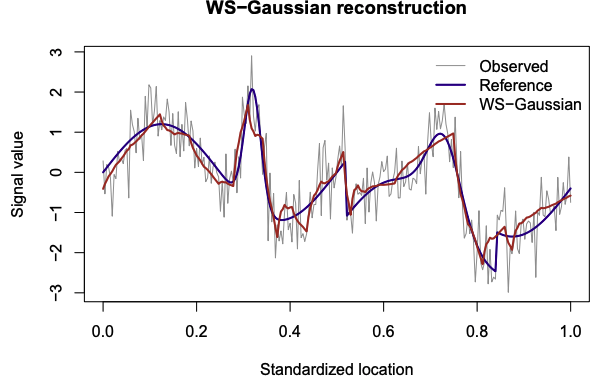{fig-alt="Gaussian Resconstruction of a Signal"}

### Ecology

[acousticTS](https://cran.r-project.org/package=acousticTS) v2.0.8: Acoustic target strength (TS) represents the intensity of an echo returning from an individual scatterer such as bubbles, fish, or zooplankton. TS can be used to convert integrated or volumetric backscatter collected from fisheries acoustic surveys into units of number density (e.g. animals per m^3), abundance (e.g. number of animals), and biomass (e.g. kg). This parameter can also be used to aid in classifying backscatter, such as separating likely echoes of large predatory fish (e.g. adult cod) from smaller prey (e.g. shrimp). Applications are described by [Lucca et al. (2023)](doi:10.1121/10.0022459), with fisheries-acoustics principles from [Simmonds and MacLennan (2005)](doi:10.1002/9780470995303). See the [vignette](https://cran.r-project.org/web/packages/acousticTS/vignettes/boundary_conditions.html).

[SAMPLE](https://cran.r-project.org/package=SAMPLE) v1.0.1: Estimates the sampling effort needed to obtain stable species occurrence and prevalence rates from presence-absence data. The method repeatedly subsamples observations, evaluates changes in estimated rates, and reports the minimum stable sample size. For methodological details, see [Bravo et al. (2025)](doi:10.1002/ece3.70998). Look [here](https://github.com/yacinebenchehida/SAMPLE) to get started.

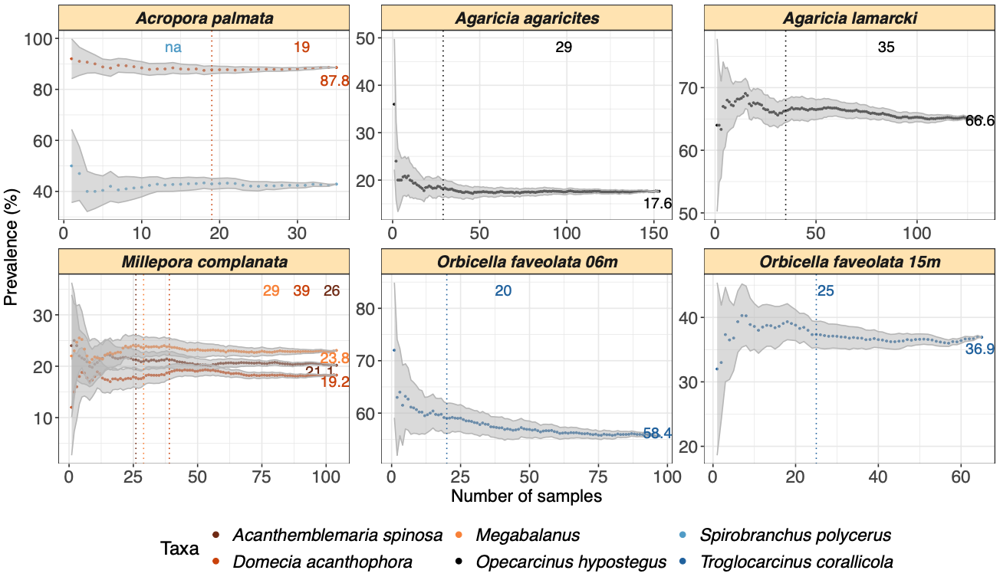{fig-alt="Plots showing how prefalence rate increases with sampling"}

### Economics

[PricingBandits](https://cran.r-project.org/package=PricingBandits) v2.1.0: Implements multi-armed bandit approaches for pricing experiments with an unknown demand curve, as developed in [Weaver, Kumar, and Jain (2025)](doi:10.1287/mksc.2022.0247). Includes Upper Confidence Bound and Thompson Sampling  baselines, Gaussian process variants, monotonic Gaussian process variants that constrain demand to be weakly decreasing in price, and heterogeneous-noise extensions. The willingness-to-pay distribution is fully user-specified via a vector of consumer valuations, so any demand environment can be simulated or replayed. See the [vignette](https://cran.r-project.org/web/packages/PricingBandits/vignettes/pricingbandits-intro.html).

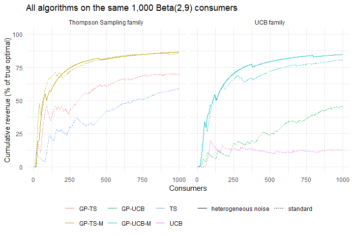{fig-alt="Plots of cumulative revenus vs Consumers"}
### Epidemiology

[ambre](https://cran.r-project.org/package=ambre) v2.1.2: Provides a Quantitative Microbial Risk Assessment framework for the reuse of treated wastewater in agricultural irrigation. Following a multi-barrier approach, the package simulates pathogen inflow and removal along a treatment train, estimates human exposure, and computes health risk indicators such as infection probability, illness probability, and Disability-Adjusted Life Years. It also supports an economic analysis of the treatment scenarios considered. For more details see [Thomas et al. (2024)](doi:10.36904/20240595). There are eight vignettes including [Get started](https://cran.r-project.org/web/packages/ambre/vignettes/a-get-started.html) and [Interpreting risk against the WHO target](https://cran.r-project.org/web/packages/ambre/vignettes/d-interpreting-risk.html)

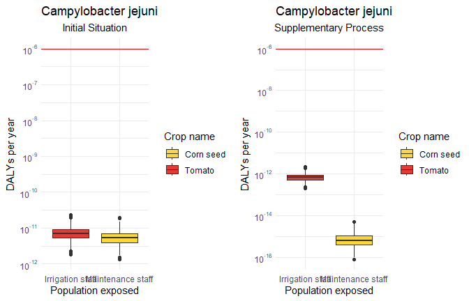{fig-alt="Plots of exposure distributions"}

[tbl.now](https://cran.r-project.org/package=tbl.now) v1.2.0: Defines tidy data structures and package-agnostic workflows for epidemiological nowcasting. The `tbl_now` class records event, report, and revision dates alongside strata, covariates tagged by model component, censoring, and reporting-delay metadata while remaining compatible with `dplyr`. Tools support validation, manipulation, diagnostics, visualization, format conversion, retrospective evaluation, and multiple modelling engines. See the [vignette](https://cran.r-project.org/web/packages/tbl.now/vignettes/tbl.now.html).

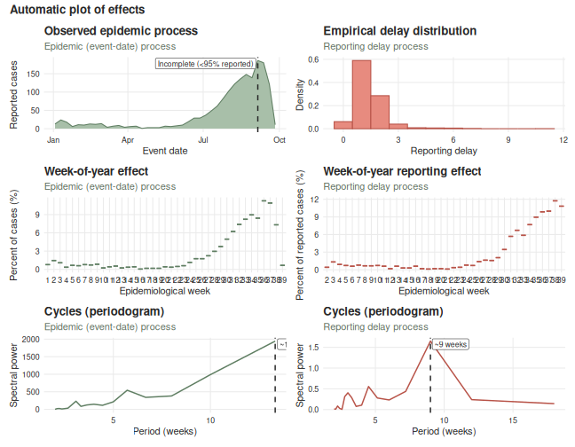{fig-alt="Automatic effects plots"}

### Genomics

[mSigSpectra](https://cran.r-project.org/package=mSigSpectra) v0.1.3: Reads variant call format (VCF) files in a caller-agnostic way, annotates variants with flanking sequence context and transcriptional strand, and builds mutational-spectrum catalogs of single base substitutions, doublet base substitutions, and small insertions and deletions at several resolutions (SBS96, SBS192, SBS1536, DBS78, DBS136, DBS144, ID83, ID89, ID166, ID476) and in both counts and density representations. Used in the preparation of [Rozen et al. (2026)](doi:10.5281/zenodo.18451842). See the [vignette](https://cran.r-project.org/web/packages/mSigSpectra/vignettes/mSigSpectra.html).

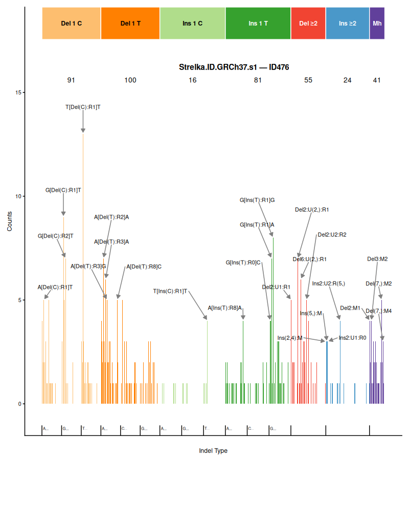{fig-alt="Plot of variant counts generated by the Strelka variant caller using the GRCh37 reference genome"}

### Machine Learning

[fastgbm](https://cran.r-project.org/package=fastgbm) v0.6.1: Implements a fast gradient boosting machine covering four task types with one interface: regression (squared error), binary and multiclass classification (logistic and one-vs-rest), and right-censored survival analysis via Cox (Breslow ties), accelerated failure time (normal location-scale), or piecewise-exponential objectives. Provides native missing-value routing, baseline-hazard estimation and survival-probability prediction for the survival objectives, and deterministic multi-threaded training via `RcppParallel`. Methods are described in [Friedman (2001)](doi:10.1214/aos/1013203451). There are six vignettes including [getting Started](https://cran.r-project.org/web/packages/fastgbm/vignettes/getting-started.html) and [Algorithm](https://cran.r-project.org/web/packages/fastgbm/vignettes/algorithm.html)'

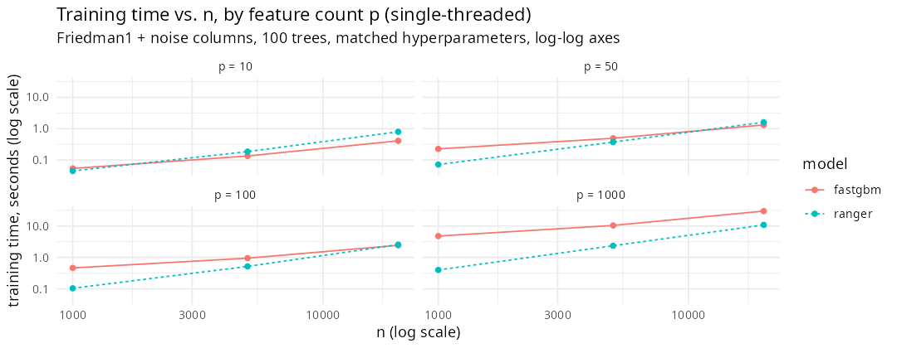{fig-alt="Plots of training times by feature count"}

[xplaineff](https://cran.r-project.org/package=xplaineff) v0.1.1: Implements the Generalized Additive Decomposition of Global EffecTs algorithm for interpretable machine learning. The package recursively partitions the feature space to minimize heterogeneity of feature effects (e.g., Accumulated Local Effects or Partial Dependence), producing a tree of regions where effects are more stable. It supports both ALE and PD strategies, works with `mlr3` learners and provides visualization of the interaction tree and regional effect plots. The method is described in [Herbinger et al. (2024)](https://jmlr.org/papers/volume25/23-0699/23-0699.pdf). See the [vignette](https://cran.r-project.org/web/packages/xplaineff/vignettes/xplaineff.html).

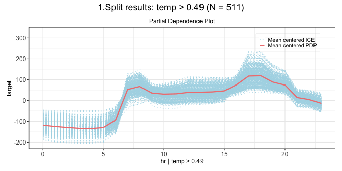{fig-alt="Partial Dependence Plot"}

### Medical Statistics

[chms](https://cran.r-project.org/package=chms) v7.2: *ActiGraph wGT3X-BT* accelerometer processing methods using the standardized workflow developed by Statistics Canada for cycle 7 of the Canadian Health Measures Survey. The package promotes transparent and reproducible data processing while supporting the harmonization of analytical approaches among researchers wishing to align with Statistics Canada's methods. For general details about the processing methods, please consult [Clarke et al. (2026)](doi:10.25318/82-003-x202600200001-eng). See [README](https://cran.r-project.org/web/packages/chms/readme/README.html) to get started.

[rsmart](https://cran.r-project.org/package=rsmart) v0.1.0: Implements the interim augmented inverse probability weighted estimator for the value of treatment regimes embedded in sequential multiple assignment randomized trials. It subsumes both the inverse probability weighted estimator and the augmented inverse probability weighted estimator, enabling inference at interim and final analyses. Provides functions for value estimation, sandwich variance computation, group sequential stopping boundaries, and sample size determination for multi-stage SMARTs. See [Manschot, Laber, and Davidian (2023)](doi:10.1111/biom.13854) for additional details. There are four vignettes including [Getting Started](https://cran.r-project.org/web/packages/rsmart/vignettes/start-here.html) and [Full demo of IAIPWE](https://cran.r-project.org/web/packages/rsmart/vignettes/iaipwe.html).

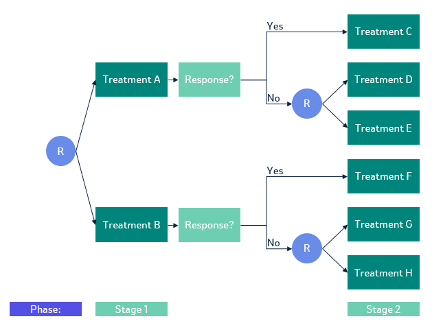{fig-alt="Diagram of SMART"}

### MetaAnalysis

[metaGLMM](https://cran.r-project.org/package=metaGLMM) v1.0.0: Extends traditional random-effects meta-analysis by embedding it within a generalized linear mixed-effects model framework. The package supports covariate adjustment and non-normal responses using aggregate data, and provides likelihood-based inference with computationally efficient likelihood evaluation. The underlying methodology is described in [Hanada and Sugimoto (2026)](doi:10.1093/biomtc/ujag148). Thereare seven vignettes including [Getting started](https://cran.r-project.org/web/packages/metaGLMM/vignettes/getting-started.html) and [Prediction and forest plots](https://cran.r-project.org/web/packages/metaGLMM/vignettes/prediction-forest.html).

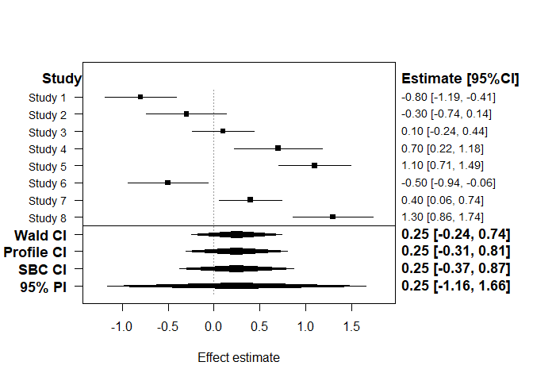{fig-alt="Forest plot showing effect size"}

### Networks

[nethist](https://cran.r-project.org/package=nethist) v1.0.0: Estimates network histograms, a blockmodel approximation to the graphon underlying a network's connectivity pattern, for both single-layer and multilayer networks. Implements graphon estimation methods including the profile-likelihood method of [Olhede and Wolfe (2014)](oi:10.1073/pnas.1400374111) and the least-squares method of [Gao, Lu, and Zhou (2015)](doi:10.1214/15-AOS1354) for single-layer networks, and the multilayer extension of [Song and Olhede (2026)](doi:10.48550/arXiv.2608.14536). See the [vignette](https://cran.r-project.org/web/packages/nethist/vignettes/example.html).

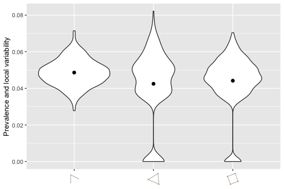{fig-alt="Violin plots summarizing network topology"}

:::

::: {.column width="10%"}

:::

::: {.column width="45%"}

### Phylogenetics

[ConsTree](https://cran.r-project.org/package=ConsTree) v1.0.0: Efficient construction of phylogenetic consensus trees. Methods include strict, majority-rule, majority-rule (+), loose (combinable component / semi-strict), greedy, Adams, frequency difference, R*, and local consensus. See the [vignette](https://cran.r-project.org/web/packages/ConsTree/vignettes/ConsTree.html).

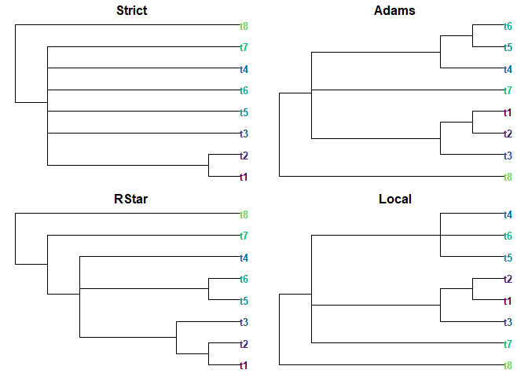{fig-alt="Plots of consensus trees"}

### Statistics

[FitVerse](https://cran.r-project.org/package=FitVerse) v1.0-2: Provides a unified interface for fitting parametric probability distributions to continuous univariate data that supports 52 distribution families spanning symmetric, right-skewed, heavy-tailed, bounded, and extreme-value shapes distributions, and three estimation methods. Automatic best-fit selection is performed using multiple criteria and tests. Includes publication-quality diagnostic plot,  histogram overlaid with density curves and optional interactive plots via `plotly`. Additional tools include bootstrap confidence intervals for parameter estimates and return levels, batch fitting across multiple columns and more. Functions support data characterisation in survey sampling, hydrology, and actuarial workflows. See [Hosking (1990)](doi:10.1111/j.2517-6161.1990.tb01775.x) for background and the [vignette](https://cran.r-project.org/web/packages/FitVerse/vignettes/fitverse-introduction.html) for examples.

{fig-alt="Plot of gitted Gumbell distribution fitted via MLE"}

[hdcce](https://cran.r-project.org/package=hdcce) v0.1.0: Estimation and inference for panel data models with interactive fixed effects. The methods cover the linear specification of Ruecker, [Vogt, Linton,and Walsh (2025)](doi:10.3982/QE2308), and the dictionary design of [Ruecker, Vogt, and Linton (2026)](doi:10.48550/arXiv.2608.02055>). See the [vignette](https://cran.r-project.org/web/packages/hdcce/vignettes/hdcce.html).

[HDElliptical](https://cran.r-project.org/package=HDElliptical) v0.1.3: Provides fast, documented implementations of robust estimation, testing, dimension reduction, classification, and clustering methods for high-dimensional elliptically symmetric data. Computational kernels use `Rcpp` and `RcppArmadillo`. The package follows methods reviewed in [Feng (2026)](https://github.com/flnankai/HDElliptical/releases). See the vignettes [Robust Directional Foundations](https://cran.r-project.org/web/packages/HDElliptical/vignettes/chapter-1-foundations.html) and [Location Tests](https://cran.r-project.org/web/packages/HDElliptical/vignettes/chapter-2-location-tests.html).

[iop](https://cran.r-project.org/package=iop) v0.1.0: Provides estimation, inference, and quantities of interest for ordered probit and ordered logit models whose outcome contains an inflated category: a single ordered category that mixes observations generated by the ordered process with observations generated by a distinct split-population process. Fits the zero-inflated ordered probit of [Harris and Zhao (2007)](doi:10.1016/j.jeconom.2007.01.002) and its middle- and top-inflated extensions (See for example [Bagozzi, Joo and Mukherjee (2024)](doi:10.1093/fpa/orae006). Also provides analytic, robust, and cluster-robust standard errors, survey weights and offsets, model comparison, regime-specific predicted probabilities and first differences and additional features. There are four vignettes including [Getting started](https://cran.r-project.org/web/packages/iop/vignettes/iop.html) and [The model, identification, and estimation](https://cran.r-project.org/web/packages/iop/vignettes/model.html).

[normalblockr](https://cran.r-project.org/package=normalblockr) v0.3.0: Implements the Normal-Block model, a Gaussian graphical model with a latent clustering structure for the multivariate analysis of continuous data that clusters variables and, building on the graphical lasso, infers a network of statistical dependencies between clusters rather than between individual variables, for known or unknown clusterings, with an optional zero-inflation extension for data with an excess of exact zeros. See [Tous & Chiquet (2026)](<doi:10.1016/j.csda.2026.108347) for the model itself and its variational expectation-maximization estimation procedure. There are four vignettes including [Mean-Block models](https://cran.r-project.org/web/packages/normalblockr/vignettes/mean-block-breast-cancer.html) and [Zero-inflated Normal-Block models](https://cran.r-project.org/web/packages/normalblockr/vignettes/zero-inflated-normal-block.html).

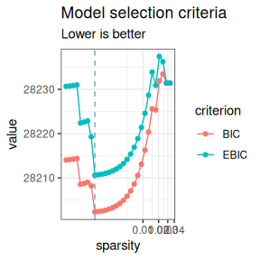{fig-alt="Plot of model selection criteria"}

[pmsims](https:/./cran.r-project.org/package=pmsims) v1.0.0: Provides a flexible, simulation-based toolkit for exploring how much data are needed to develop reliable prediction models. It works by repeatedly generating data, fitting models, and evaluating performance to show how sample size affects predictive accuracy, calibration, and overfitting. The package supports continuous, binary, and time-to-event outcomes and can be used with both regression-based modelling approaches and machine-learning methods. Methods are described in [Olaniran et al. (2026)](doi:10.1186/s12874-026-02935-9) and [Shamsutdinova et al. (2026)](doi:10.48550/arXiv.2602.23507). See the [vignette](https://cran.r-project.org/web/packages/pmsims/vignettes/pmsims.html).

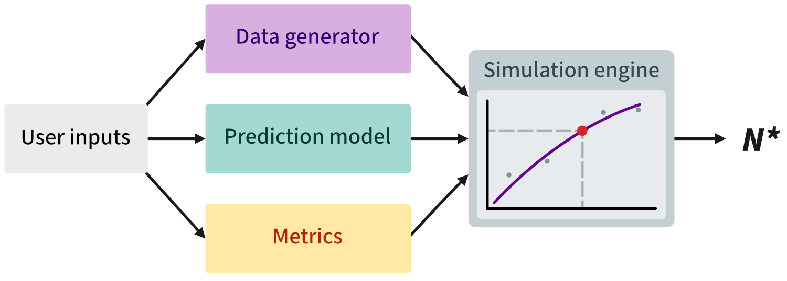{fig-alt="Package workflow diagram"}

[spfcICOMP](https://cran.r-project.org/package=spfcICOMP) v0.1.0: Implements shrinkage principal fitted components for sufficient dimension reduction in high-dimensional regression and classification. Provides regularised covariance estimation using Oracle Approximating Shrinkage and Maximum Entropy Covariance, structural-dimension selection using conventional and information-complexity criteria, response-guided feature screening, reduced-space prediction, and simulation utilities. Methodological foundations include [Cook and Forzani (2008)](doi:10.1214/08-STS275), [Chen et al. (2010)](doi:10.1109/TSP.2010.2053029), [Bozdogan (2000)](doi:10.1006/jmps.1999.1277), and [Olorede and Yahya (2019)](doi:10.48550/arXiv.1909.13017). See the [vignette](https://cran.r-project.org/web/packages/spfcICOMP/vignettes/getting-started.html).

[sptrends](https://cran.r-project.org/package=sptrends) 1.6.3: Provides a unified and reproducible framework for statistical inference of spatiotemporal trends in gridded environmental data that addresses the interconnected challenges of serial correlation, spatial dependence and multiple testing that commonly arise when analysing gridded environmental time series. Core methods support serial-correlation treatment through trend-preserving prewhitening, pixel-wise and spatially explicit trend inference, slope estimation and multiple-testing correction. Dedicated workflows reproduce published methodologies, for example [Gutiérrez-Hernández and García (2025)](doi:10.1016/j.rsase.2024.101377) for True Significant Trends workflow and [Gutiérrez-Hernández and García (2024)](doi:10.3390/rs16203886) for Robust Trend Analysis workflow. Supporting utilities facilitate raster data import and inspection, anomaly calculation, spatial autocorrelation diagnostics, and more. There are six vignettes including: [Dealing with serial correlation](https://cran.r-project.org/web/packages/sptrends/vignettes/b-prewhitening.html) and [Trend magnitude estimation](https://cran.r-project.org/web/packages/sptrends/vignettes/d-slope-estimation.html).

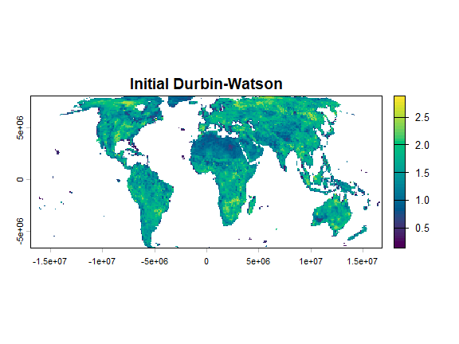{fig-alt="Plot indicating serial correlation"}

[ZINB.GP](https://cran.r-project.org/package=ZINB.GP) v1.0.0: Fits Bayesian zero-inflated negative binomial regression models with Gaussian process random effects for spatial, temporal, or spatiotemporal count data. Provides Markov chain Monte Carlo sampling, configurable random effects in the zero-inflation and count components, and posterior predictive draws. Implements a full GP version of the methods described by [He and Huang (2024)](doi:10.1016/j.jspi.2023.106098). See the vignettes [Oregon Landslides](https://cran.r-project.org/web/packages/ZINB.GP/vignettes/oregon-landslides.html) and [Simulating and Fitting a Spatiotemporal ZINB-GP Model](https://cran.r-project.org/web/packages/ZINB.GP/vignettes/simulating-zinb-gp.html).

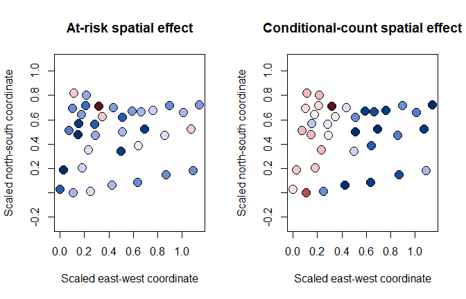{fig-alt="Plots of At-Risk and Coditional spatial effects"}

End

:::

::::

